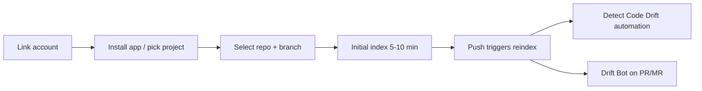

# Codebase Connection

> [[raw/docs/llms-docs-8090-ai/codebase-overview|Raw]] · llms-txt · 8090 docs, Connections

## Summary

This page documents how a project in 8090 Software Factory connects to source code. Connecting a repository makes the platform index the code so agents can search and read it, and the index stays current as the team pushes. Providers are GitHub (repositories) and GitLab (projects); both can be used in one project, and each connection tracks a single selected branch. [[raw/docs/llms-docs-8090-ai/codebase-overview#choose-a-provider|cite]]

Authorization differs by provider. GitHub needs a linked account plus the 8090 GitHub App installed on the target repositories, and in an organization only an owner or admin can install it. GitLab needs a linked account and a project access token, created the first time anyone connects the project; that requires the Maintainer role and a GitLab Premium or Ultimate plan. [[raw/docs/llms-docs-8090-ai/codebase-overview#connect-github|cite]] [[raw/docs/llms-docs-8090-ai/codebase-overview#connect-gitlab|cite]]

The second half covers drift detection: comparing code against the project's Blueprints and Requirements (8090's spec artifacts). Two opt-in mechanisms exist, the Detect Code Drift automation (after push) and Drift Bot (on pull requests).

## Key claims

- Initial indexing usually takes 5 to 10 minutes; pushes to the selected branch reindex automatically, and manual reindex or branch change is in the row's actions menu. [[raw/docs/llms-docs-8090-ai/codebase-overview#after-you-connect|cite]]
- Detect Code Drift is an automation that runs after pushes and leaves drift comments on affected Blueprints and linked Requirements; both drift options are off by default. [[raw/docs/llms-docs-8090-ai/codebase-overview#after-you-connect|cite]]
- Drift Bot reviews GitHub PRs and GitLab MRs, flagging code that contradicts a Blueprint or Requirement and code none of them cover. It runs on commit to a branch with an open PR (drafts skipped) or manually via a `/driftbot` comment. [[raw/docs/llms-docs-8090-ai/codebase-overview#choose-when-it-runs|cite]]
- Output is one summary comment, line comments on the most important findings, and a `drift-bot` commit status that fails on drift or run failure. [[raw/docs/llms-docs-8090-ai/codebase-overview#what-drift-bot-posts|cite]]
- Each Drift Bot run uses the access of the triggering person, who must be an org member with a linked GitHub/GitLab account; saving settings needs the Codebase Connection Editor permission. [[raw/docs/llms-docs-8090-ai/codebase-overview#who-can-set-it-up|cite]]
- Only one project per repository can run Drift Bot (the first to enable it); it must be turned off there before unlinking or archiving. [[raw/docs/llms-docs-8090-ai/codebase-overview#several-projects-on-one-repository|cite]]
- Unlinking a repository does not uninstall the GitHub App; for GitLab, unlinking the last org project using it revokes the access token it created. [[raw/docs/llms-docs-8090-ai/codebase-overview#manage-connections|cite]]

## Notable quotes

> "Drift Bot is already enabled by another project connected to this repository. Disable it there before enabling it here."
> — [[raw/docs/llms-docs-8090-ai/codebase-overview#several-projects-on-one-repository|Several projects on one repository]]

## Connections

- **Entities**: [[wiki/entities/github]]
- **Concepts**: none yet

> Synthesis: Product-docs view of spec-to-code drift checking (code reviewed against Blueprints/Requirements); a candidate `drift-detection` concept if another origin covers it.
