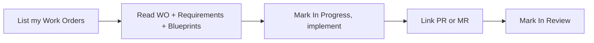

# Coding Agent Connection

> [[raw/docs/llms-docs-8090-ai/connections-connect-coding-agent|Raw]] · llms-txt · https://docs.8090.ai/connections/connect-coding-agent

## Summary

This docs page explains how a developer wires an external coding agent to an 8090 Software Factory project. The product runs a Model Context Protocol (MCP) server; an agent connected to it can list Work Orders, read the Requirements, Blueprints and Knowledge Base behind them, and post status back from the editor or terminal. The server also exposes project skills, feedback, themes, comments, version history, automations and the user's past agent conversations. [[raw/docs/llms-docs-8090-ai/connections-connect-coding-agent#coding-agent-connection-connections-connect-coding-agent|cite]]

Setup is per project. All connections target one server URL and carry a project-scoping header; auth is browser OAuth. The page gives config shapes for Cursor, Claude Code, Claude Desktop and Codex, plus a generic JSON for others (Windsurf, Pi, Factory.ai; VS Code and OpenCode use different schemas). Exact snippets come from Settings > Connections > Coding Agent or the MCP Setup dialog on Work Orders.

The page ends with the intended agent loop: find assigned Work Orders, read linked context, mark In Progress and implement, link the pull request, then mark In Review for a teammate.

## Key claims

- Server URL is `https://api.factory.8090.dev/v2/mcp`, named `software-factory-<project slug>`, scoped by header `X-Sofa-Mcp-Project-Id`, authenticated by browser OAuth. [[raw/docs/llms-docs-8090-ai/connections-connect-coding-agent#get-your-connection-details|cite]]
- Claude Code is configured with `claude mcp add --transport http --scope user ...`, then `/mcp` > Authenticate; Codex gets a script that edits `~/.codex/config.toml`. [[raw/docs/llms-docs-8090-ai/connections-connect-coding-agent#claude-code|cite]] [[raw/docs/llms-docs-8090-ai/connections-connect-coding-agent#codex|cite]]
- Deleting Work Orders, Requirements, Blueprints, Knowledge Base items, skills, feedback or themes, and any automation create/edit/delete, require user confirmation; agents that cannot show confirmations cannot perform these actions. [[raw/docs/llms-docs-8090-ai/connections-connect-coding-agent#confirmations|cite]]
- A PR links to a Work Order by URL (GitHub PR or GitLab MR), by number on GitHub, or automatically when title/description contains an ID like `WO-123`; the repository must be connected via Codebase Connection. [[raw/docs/llms-docs-8090-ai/connections-connect-coding-agent#link-the-pull-request|cite]]
- Linked PRs show status Open, Draft, Merged or Closed in the Work Order's Development section. [[raw/docs/llms-docs-8090-ai/connections-connect-coding-agent#link-the-pull-request|cite]]

## Notable quotes

> "Any coding agent that supports MCP can connect."
> — [[raw/docs/llms-docs-8090-ai/connections-connect-coding-agent#coding-agent-connection-connections-connect-coding-agent|intro]]

> "If your agent can't show these confirmations, these actions aren't available to it."
> — [[raw/docs/llms-docs-8090-ai/connections-connect-coding-agent#confirmations|Confirmations]]

## Connections

- **Entities**: [[wiki/entities/claude-code]], [[wiki/entities/codex]], [[wiki/entities/github]]
- **Concepts**: [[wiki/concepts/human-in-the-loop]]

> Synthesis: Shows 8090 as a control surface that external agent harnesses plug into over MCP, with destructive actions gated on human confirmation; Claude Code, Codex and GitHub appear as integration targets, not as subjects.
