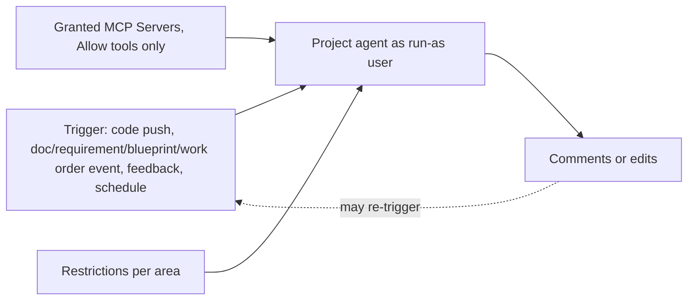

# 8090 Software Factory Automations

> [[raw/docs/llms-docs-8090-ai/modules-automations|Raw]] · llms-txt

## Summary

Vendor documentation for the Automations module of 8090 Software Factory. An automation runs the project agent on a trigger instead of a chat prompt: the user defines the work once, and the agent runs when the right event happens or a schedule comes due. [[raw/docs/llms-docs-8090-ai/modules-automations#Automations|cite]]

Each automation has four parts: triggers, agent instructions (prompt plus model), optional MCP Servers, and optional restrictions. It runs as its creator, the "run-as user", with that person's permissions. Restrictions only narrow that access. MCP Servers are opt-in per automation, unlike chat. [[raw/docs/llms-docs-8090-ai/modules-automations#What an automation contains|cite]] [[raw/docs/llms-docs-8090-ai/modules-automations#Permissions and restrictions|cite]]

The page also covers a catalog of recommended automations (mostly drift detection between code, blueprints and requirements), four worked recipes, run history, and best practices. Safety design centers on read-only areas and comment-only output, which also avoids self-triggering loops.

## Key claims

- Triggers include Code Push (after reindex), created/edited events for Knowledge Base documents, requirements, blueprints and work orders, Feedback Created, and Scheduled. An automation can have several triggers but only one Scheduled. [[raw/docs/llms-docs-8090-ai/modules-automations#Triggers|cite]]
- Edited triggers fire once per saved version, not per keystroke. Each run opens with a note about what triggered it. [[raw/docs/llms-docs-8090-ai/modules-automations#What a run receives|cite]]
- Restrictions have two levels, "Cannot create" and "Cannot edit or create", across Knowledge Base, Requirements, Blueprints, Work Orders, Feedback, Themes and Comments. [[raw/docs/llms-docs-8090-ai/modules-automations#Permissions and restrictions|cite]]
- Automations use only MCP tools set to Allow, because nobody is present to approve a tool during a run. [[raw/docs/llms-docs-8090-ai/modules-automations#MCP Servers|cite]]
- Recommended automations Detect Code Drift, Sync Blueprints and Requirements, and Check Blueprint References report drift as comments and cannot edit documents. [[raw/docs/llms-docs-8090-ai/modules-automations#What's in the catalog|cite]]
- Only the run-as user can open and continue a run; replies use that user's own permissions, not the automation's restrictions. A run fails once the user's usage limit is hit. [[raw/docs/llms-docs-8090-ai/modules-automations#Run history|cite]]
- Automations can be managed via REST API and via coding agents over MCP, with confirmation before create, edit or delete. [[raw/docs/llms-docs-8090-ai/modules-automations#Authoring an automation|cite]]

## Notable quotes

> "If an automation can edit the same kind of item that triggers it, its own edits can trigger it again in a loop."
> — [[raw/docs/llms-docs-8090-ai/modules-automations#Permissions and restrictions|Permissions and restrictions]]

## Connections

- **Entities**: none linked.
- **Concepts**: [[wiki/concepts/human-in-the-loop]]

> Synthesis: Vendor doc for an unattended-agent design (run-as identity, Allow-only tools, comment-only output) that trades approval gates for scoping; no other source covered here.
