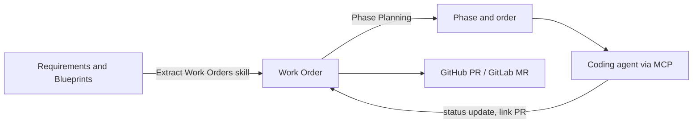

# Work Orders

> [[raw/docs/llms-docs-8090-ai/modules-work-orders|Raw]] · llms-txt

## Summary

Module reference for 8090 Software Factory. A Work Order is a task that moves the system toward the target state set by Requirements and Blueprints. Each one bundles metadata (ID, assignee, parent, phase, status, priority, type, labels), a description with acceptance criteria and out-of-scope limits, context links to upstream artifacts, dependencies, linked pull requests, and an activity history. [[raw/docs/llms-docs-8090-ai/modules-work-orders#Work Orders|cite]]

Creation is either agent-driven (the **Extract Work Orders** skill reads Blueprints and Requirements, follows the project's writing rules, and proposes work orders for review) or manual. Planning is then a loop: create or extract, place into phases (the **Phase Planning** skill can propose phases), and order within a phase. [[raw/docs/llms-docs-8090-ai/modules-work-orders#Getting started|cite]] How the agent writes work orders is itself an editable skill, **Work Orders Writing Rules**, seeded from organization templates. [[raw/docs/llms-docs-8090-ai/modules-work-orders#Configure Work Order settings|cite]]

Execution links back to code. A Development section links GitHub pull requests or GitLab merge requests, by hand, by mentioning an ID like `WO-123` in the PR, or through the agent or MCP. PR state (Open, Draft, Merged, Closed) shows in the Table, Board and Roadmap views. [[raw/docs/llms-docs-8090-ai/modules-work-orders#Pull requests|cite]] Through MCP, a developer's coding agent can list assigned Ready work orders, read their context, search Requirements, Blueprints and Knowledge Base files, update status, and link PRs. [[raw/docs/llms-docs-8090-ai/modules-work-orders#MCP connections|cite]]

## Key claims

- Five status categories (Backlog, Unstarted, Started, Completed, Canceled); built-in statuses are fixed, custom ones can be added, and a status category cannot be changed after creation. [[raw/docs/llms-docs-8090-ai/modules-work-orders#Statuses|cite]]
- Types are Build, Fix, Requirements, Blueprint, Knowledge Base, Other; priorities run Urgent to Low plus No Priority. [[raw/docs/llms-docs-8090-ai/modules-work-orders#Work order details|cite]]
- Work orders, feedback items and themes share one label set. [[raw/docs/llms-docs-8090-ai/modules-work-orders#Labels, filters, and search|cite]]
- Views are Table, Board and Roadmap, with grouping, sort, filters, and shared Saved Views; the Roadmap draws bars from phase dates, so a phase with no dates gets no bar. [[raw/docs/llms-docs-8090-ai/modules-work-orders#Roadmap|cite]]
- Work orders do not update themselves when Blueprints change; the user must ask the agent to review them or re-run Extract Work Orders. [[raw/docs/llms-docs-8090-ai/modules-work-orders#When blueprints change|cite]]
- The agent can bulk-create, edit and delete work orders; built-in skills are Extract Work Orders, Phase Planning, Review Current Phase and Duplication Check. [[raw/docs/llms-docs-8090-ai/modules-work-orders#Agent capabilities|cite]]
- Agent chats on a work order are visible by title to all, but only the starter can open their own. [[raw/docs/llms-docs-8090-ai/modules-work-orders#Work order details|cite]]

## Notable quotes

> "Use agent actions for extraction, bulk updates, and phase planning while reserving judgment calls for people."
> — [[raw/docs/llms-docs-8090-ai/modules-work-orders#Best practices|Best practices]]

> "Together they are the contract between Blueprints and execution."
> — [[raw/docs/llms-docs-8090-ai/modules-work-orders#Best practices|Best practices]]

## Connections

- **Entities**: [[wiki/entities/github]]
- **Concepts**: [[wiki/concepts/agent-skill]], [[wiki/concepts/human-in-the-loop]]

> Synthesis: Vendor product docs, not argument; they show a UI-first planning layer (Blueprints to phased work orders to PRs) where agents propose and people review, with MCP as the bridge to developers' coding agents.
