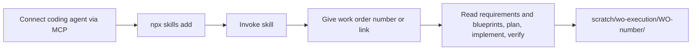

# Agent Skill

> [[raw/docs/llms-docs-8090-ai/opinions-agent-skill|Raw]] · llms-txt · https://docs.8090.ai/opinions/agent-skill

## Summary

This short page from 8090's "Best practices" section describes the 8090 Software Factory agent skill. It defines an agent skill as a modular bundle of instructions, scripts and resources an agent loads at runtime to do a task with the right procedures and context. [[raw/docs/llms-docs-8090-ai/opinions-agent-skill#agent-skill-opinionsagent-skill|cite]] The 8090 skill teaches an agent how to use the platform and run Work Orders consistently.

The skill and MCP split the job. The skill supplies the workflow. MCP supplies access to the project's requirements, blueprints and work orders. So MCP must be connected first. [[raw/docs/llms-docs-8090-ai/opinions-agent-skill#agent-skill-opinionsagent-skill|cite]]

The page also fixes where the agent keeps its state during a work order, so the run can be resumed, inspected and reviewed afterwards.

## Key claims

- Install with `npx skills add 8090-inc/software-factory-plugin`, or paste the "Install the Software Factory skill" prompt from Quick Start into the agent. [[raw/docs/llms-docs-8090-ai/opinions-agent-skill#install-the-skill|cite]]
- Cursor invokes it explicitly with `/software-factory`. Other agents load it when the prompt mentions Software Factory, a requirement, a blueprint or a work order. [[raw/docs/llms-docs-8090-ai/opinions-agent-skill#invoke-the-skill|cite]]
- Executing a work order means giving the agent its number or link. The skill guides reading related requirements and blueprints, planning, implementation and verification. [[raw/docs/llms-docs-8090-ai/opinions-agent-skill#execute-a-work-order|cite]]
- Per work order, the agent creates `scratch/wo-execution/WO-<number>/` holding `implementation-plan.md`, `checklist.md`, `context.md` and `verification-log.md`. [[raw/docs/llms-docs-8090-ai/opinions-agent-skill#execution-state|cite]]
- The folder records what was read, planned, changed, reviewed and verified, which makes the work order easier to resume, inspect and review. [[raw/docs/llms-docs-8090-ai/opinions-agent-skill#execution-state|cite]]

## Notable quotes

> "The skill provides the workflow, while MCP provides access to your 8090 Software Factory project."
> — [[raw/docs/llms-docs-8090-ai/opinions-agent-skill#agent-skill-opinionsagent-skill|Connect MCP before installing the skill]]

## Connections

- **Entities**: none engaged. Cursor is named only as the one agent with an explicit slash command.
- **Concepts**: [[wiki/concepts/agent-skill]], [[wiki/concepts/mcp]]

> Synthesis: 8090 uses the same skill-plus-MCP split as Warp's custom skills, but adds a file-based execution trail per work order that doubles as a verification record.
