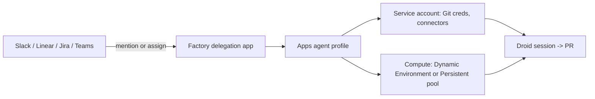

# Delegations

> [[raw/docs/llms-docs-factory-com/delegations-index|Raw]] · llms-txt · Factory docs, Documentation

## Summary

Delegations lets a team send work to Droid, Factory's agent, from chat and ticketing tools: Slack, Linear, Jira and Microsoft Teams. A user mentions `@Factory` or assigns an issue, and Droid works on a remote computer under the organization's agent profile. [[raw/docs/llms-docs-factory-com/delegations-index#delegations|cite]]

The design splits "who asks" from "who runs". An administrator (Manager or Owner role) configures instructions, plugins, a service-account identity and compute once, in the **Apps** agent profile. Team members then delegate without picking a machine. Shared channel and issue delegations run as the service account, with its Git credentials and connectors. Slack DMs are the exception: they run as the sender, with personal credentials and connectors. [[raw/docs/llms-docs-factory-com/delegations-index#personal-and-shared-identity|cite]]

The page is mostly an operations guide: prerequisites, per-app setup, profile tabs (General, Plugins, Identity, Compute), repository access per source-control host, personal defaults, a first-task recipe, branch-protection advice and troubleshooting.

## Key claims

- Compute is either **Dynamic** (an Environment) or **Persistent** (computers in the service account's pool); dynamic needs an Environment, persistent needs at least one computer. [[raw/docs/llms-docs-factory-com/delegations-index#configure-delegated-sessions|cite]]
- Shared delegations clone and push as the service account, not the user's or the org's OAuth connection. GitHub uses the Factory GitHub App installation; GitLab and GitLab Self-Hosted need a group access token with `api` scope and at least Developer role. [[raw/docs/llms-docs-factory-com/delegations-index#repository-access-for-the-service-account|cite]]
- If the Environment holds any repository the service account cannot reach, shared delegations fail before Droid starts, even when the request ignores that repo. [[raw/docs/llms-docs-factory-com/delegations-index#repository-access-for-the-service-account|cite]]
- Personal defaults (DM machine, model, reasoning level, extra instructions) follow the requester but never change identity or connector access. Personal instructions are appended after profile instructions. [[raw/docs/llms-docs-factory-com/delegations-index#set-personal-delegation-defaults|cite]]
- Each app workspace (Slack workspace, Linear workspace, Jira site) connects to only one Factory organization at a time. [[raw/docs/llms-docs-factory-com/delegations-index#troubleshooting|cite]]
- Individual and Teams plans get one service account reserved for Delegations; it can be deactivated but not deleted. [[raw/docs/llms-docs-factory-com/delegations-index#prerequisites|cite]]

## Notable quotes

> "GitHub prevents authors from approving their own pull requests, but the requester can still approve a Factory-authored pull request."
> — [[raw/docs/llms-docs-factory-com/delegations-index#require-independent-github-review|location]]

> "Delegation apps receive requests from your team. Connectors give Droid tools to use while carrying out those requests."
> — [[raw/docs/llms-docs-factory-com/delegations-index#delegations|location]]

## Connections

- **Entities**: [[wiki/entities/slack]], [[wiki/entities/linear]], [[wiki/entities/jira]], [[wiki/entities/microsoft-teams]], [[wiki/entities/github]], [[wiki/entities/gitlab]]
- **Concepts**: [[wiki/concepts/dev-environment]], [[wiki/concepts/human-in-the-loop]]

> Synthesis: Factory's answer to "agent as teammate in existing tools" is a shared service-account identity with a mandatory human review gate advised via branch protection; the self-approval gap it flags is a concrete human-in-the-loop caveat.
