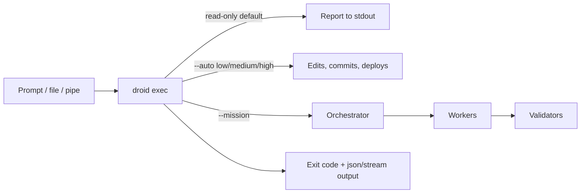

# Droid Exec (Headless)

> [[raw/docs/llms-docs-factory-com/droid-exec-overview|Raw]] · llms-txt · Factory docs, Documentation

## Summary

`droid exec` is the headless mode of Factory's Droid CLI. Unlike the interactive CLI it runs one task, writes to stdout/stderr and exits, so it fits CI/CD pipelines, shell scripts and batch jobs. The page states four goals: non-interactive, secure by default, composable, clean output. [[raw/docs/llms-docs-factory-com/droid-exec-overview#summary-and-goals|cite]]

The safety model is tiered autonomy. A bare run is read-only. `--auto low|medium|high` unlocks file edits, then local dev operations (installs, tests, commit, pull), then remote writes and deployments. `--skip-permissions-unsafe` drops prompts and is meant only for disposable environments. A run that hits an action above its level stops, prints to stderr and exits non-zero. Permission rules can allow, ask or block commands; a one-shot run cannot answer an `ask`, and `droid rules check` previews policy. [[raw/docs/llms-docs-factory-com/droid-exec-overview#autonomy-levels|cite]]

Beyond single runs, the page covers structured output (`json`, `stream-json`, `stream-jsonrpc` for custom clients and SDKs), `--worktree` for parallel jobs, tool and builtin-skill controls, custom models (BYOK), session fork/continue, tagging, and Mission Mode, a multi-agent orchestrator with worker and validator models. It ends with batch patterns (xargs, chunked review, GitHub Actions matrix).

## Key claims

- Default run is read-only; `--auto` levels gate edits (low), local dev ops incl. `git commit` (medium), and `git push`/deploys/migrations (high). [[raw/docs/llms-docs-factory-com/droid-exec-overview#autonomy-levels|cite]]
- Exit `0` means Droid finished, not that the task succeeded; verify with tests, linters or `jq`. [[raw/docs/llms-docs-factory-com/droid-exec-overview#exit-behavior|cite]]
- `-w, --worktree` runs each job in an isolated git worktree so parallel `droid exec` runs avoid file conflicts; clean worktrees are removed on exit, dirty ones kept. [[raw/docs/llms-docs-factory-com/droid-exec-overview#working-directory|cite]]
- `--input-format stream-jsonrpc` lets a client drive Droid as a long-lived subprocess; teams build agent UIs, job runners and policy layers on it, with TypeScript and Python SDKs preferred. [[raw/docs/llms-docs-factory-com/droid-exec-overview#build-custom-flows-on-raw-json-rpc|cite]]
- Tools can be restricted by name or by MCP server (`--only-tools`, `--add-tools MCP:<server>`), and `--disable-builtin-skills` removes Factory skills while keeping user, project and plugin skills. [[raw/docs/llms-docs-factory-com/droid-exec-overview#tool-controls|cite]] [[raw/docs/llms-docs-factory-com/droid-exec-overview#skill-controls|cite]]
- Mission Mode (`--mission`) plans, delegates to workers and validates, and requires `--auto high` or `--skip-permissions-unsafe`. [[raw/docs/llms-docs-factory-com/droid-exec-overview#mission-mode|cite]]
- PR review, security review and PR description ship as the packaged GitHub action `Factory-AI/droid-action`, so they need no custom `droid exec` scripting. [[raw/docs/llms-docs-factory-com/droid-exec-overview#batch-and-parallel-patterns|cite]]

## Notable quotes

> "Commit and push in your own script steps instead of giving Droid `--auto high`."
> — [[raw/docs/llms-docs-factory-com/droid-exec-overview#best-practices|Best practices]]

> "Exit `0` means Droid finished, not that the task succeeded."
> — [[raw/docs/llms-docs-factory-com/droid-exec-overview#exit-behavior|Exit behavior]]

## Connections

- **Entities**: [[wiki/entities/github]]
- **Concepts**: [[wiki/concepts/agent-harness]], [[wiki/concepts/agent-skill]], [[wiki/concepts/human-in-the-loop]], [[wiki/concepts/mcp]], [[wiki/concepts/git-worktree]]

> Synthesis: Reference page for a CLI agent harness run as a CI building block; its least-privilege autonomy tiers and worktree fan-out parallel Warp-style cloud-agent runners, but this is a single-vendor product doc, not a factory design.
