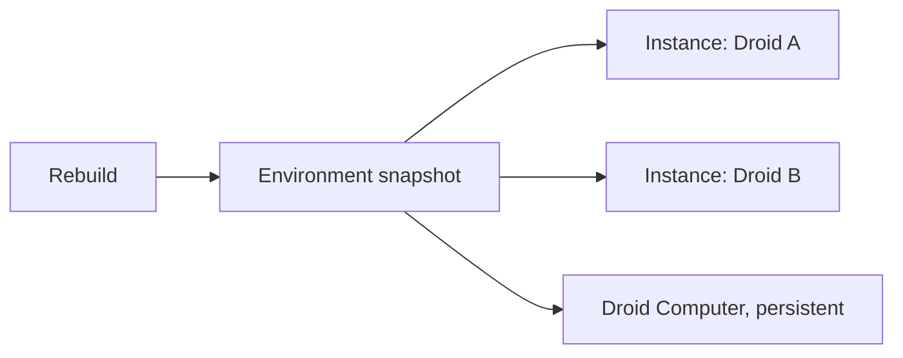

# Environments

> [[raw/docs/llms-docs-factory-com/environments-overview|Raw]] · llms-txt · Factory docs, Environments

## Summary

This page introduces the Environment in Factory: a saved development environment that Droids (Factory's agents) run on. A user picks a source, adds repositories and defines setup commands; Factory then builds a reusable snapshot with code cloned and tools installed, so each new instance starts from the same prepared baseline. Environments succeed Cloud Templates. [[raw/docs/llms-docs-factory-com/environments-overview#environments|cite]]

The model is baseline, not shared workspace. Many independent instances can start from one Environment (bug fixes, code review, browser testing), but changes in one instance never touch the Environment or another Droid's files. To update the baseline, rebuild it; to keep work, commit and push. [[raw/docs/llms-docs-factory-com/environments-overview#when-a-reusable-baseline-helps|cite]]

The page also positions Environments among three compute options and says where they plug in: Delegations, Automations and Missions.

## Key claims

- An Environment builds a snapshot with repositories cloned and tools installed; each new instance starts from it. [[raw/docs/llms-docs-factory-com/environments-overview#environments|cite]]
- Instances are isolated; Environment changes require a rebuild, and work to keep must be committed and pushed. [[raw/docs/llms-docs-factory-com/environments-overview#when-a-reusable-baseline-helps|cite]]
- Three compute options: Environment (reusable snapshot, parallel Droids), Droid Computer (persistent Factory-managed machine), Remote Control (a computer you already manage; builds no Environment). [[raw/docs/llms-docs-factory-com/environments-overview#choose-your-compute|cite]]
- A persistent Droid Computer can be created from a Ready Environment. [[raw/docs/llms-docs-factory-com/environments-overview#choose-your-compute|cite]]
- Delegations (Dynamic compute), Automations (run target) and Missions (worker agents on separate instances) can all use Environments. [[raw/docs/llms-docs-factory-com/environments-overview#use-the-same-baseline-across-workflows|cite]]
- Setup starts with source-control and runtime-secret prerequisites, then creation in Settings, Environments; availability depends on org rollout and compute settings. [[raw/docs/llms-docs-factory-com/environments-overview#use-the-same-baseline-across-workflows|cite]]

## Notable quotes

> "An Environment is the baseline, not a shared working directory."
> — [[raw/docs/llms-docs-factory-com/environments-overview#when-a-reusable-baseline-helps|When a reusable baseline helps]]

## Connections

- **Entities**: none yet
- **Concepts**: [[wiki/concepts/dev-environment]]

> Synthesis: Factory's take on the reproducible agent sandbox, snapshot baseline plus ephemeral instances; compare with other docs sets' dev-environment treatments.
