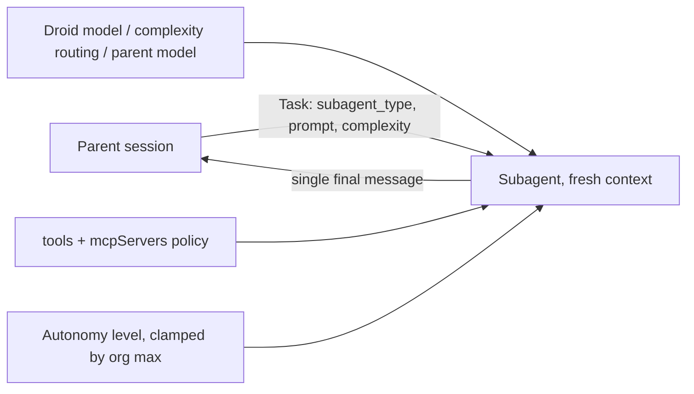

# Custom droids (subagents)

> [[raw/docs/llms-docs-factory-com/harness-subagents|Raw]] · llms-txt · Factory docs, Harness

## Summary

A custom droid is a reusable subagent in Factory's Droid agent, defined as a Markdown file with YAML frontmatter (name, description, model, reasoningEffort, tools, mcpServers) and a system-prompt body. Droid delegates focused work (code review, security sweep, research) to it through the Task tool, and every invocation runs in a fresh context window. The subagent returns one final message, runs non-interactively (no AskUser), and cannot spawn further subagents. [[raw/docs/llms-docs-factory-com/harness-subagents#custom-droids-subagents|cite]]

Droids live in `<repo>/.factory/droids/` (shared with the team; wins on name clash) or `~/.factory/droids/` (personal). Two built-ins, `worker` (all tools) and `explorer` (read-only), need no definition. The page contrasts droids with skills: a droid is a separate agent and an enforced runtime tool boundary, a skill is an inline instruction set. [[raw/docs/llms-docs-factory-com/harness-subagents#custom-droids-vs-skills|cite]]

The rest is control surface: tool categories, per-droid MCP server scoping, autonomy levels, a model-resolution order with complexity routing, org-level enterprise caps, and an import path from Claude Code agents.

## Key claims

- Task accepts `subagent_type`, `description`, `prompt`, plus optional `image_paths`, `complexity` (light/medium/heavy), `run_in_background` (returns a `task_id`; fetch with `TaskOutput`, stop with `TaskStop`) and `resume` (continue with full context). [[raw/docs/llms-docs-factory-com/harness-subagents#invoking-custom-droids|cite]]
- Tool policy: `tools` omitted allows everything; accepts a category (`read-only`, `edit`, `execute`, `web`, `mcp`) or an ID array. `TodoWrite` and `Skill` are always included; `ExitSpecMode` and `GenerateDroid` are forbidden; `tools: all` is rejected. [[raw/docs/llms-docs-factory-com/harness-subagents#configuration|cite]]
- `mcpServers` scopes which MCP servers a droid reaches; `[]` excludes all, omitting keeps the parent's set, and enterprise-blocked servers stay blocked. [[raw/docs/llms-docs-factory-com/harness-subagents#selecting-mcp-servers|cite]]
- Model resolves in order: droid-pinned model, complexity-to-model routing (when `inherit`), parent model, then fallback to parent if the pinned model is blocked by org policy. [[raw/docs/llms-docs-factory-com/harness-subagents#model-selection|cite]]
- Subagent autonomy (`inherit`/off/low/medium/high) is clamped to the org Maximum Autonomy Level; read-only droids never exceed Low, and Spec Mode forces read-only. [[raw/docs/llms-docs-factory-com/harness-subagents#autonomy-level|cite]]
- Admins pin `subagentAutonomyLevel`, `maxAutonomyLevel` and `subagentModelSettings` centrally; org values cannot be weakened downstream. [[raw/docs/llms-docs-factory-com/harness-subagents#enterprise-controls|cite]]
- `/droids` can import agents from `.claude/agents/` and `~/.claude/agents/`, mapping name, prompt, model family and tools. [[raw/docs/llms-docs-factory-com/harness-subagents#import-from-claude-code|cite]]

## Notable quotes

> "A custom droid is a runtime tool boundary and a separate agent. A skill is a discoverable instruction set."
> — [[raw/docs/llms-docs-factory-com/harness-subagents#custom-droids-vs-skills|Custom droids vs skills]]

> "If something is unclear or blocked, the subagent reports back instead of prompting."
> — [[raw/docs/llms-docs-factory-com/harness-subagents#custom-droids-subagents|Custom droids (subagents)]]

## Connections

- **Entities**: [[wiki/entities/claude-code]]
- **Concepts**: [[wiki/concepts/agent-skill]], [[wiki/concepts/agent-harness]], [[wiki/concepts/mcp]]

> Synthesis: Factory's analogue of Claude Code subagents (and format-compatible via import); a candidate `subagent` concept and `autonomy-levels` concept if another origin covers them.
