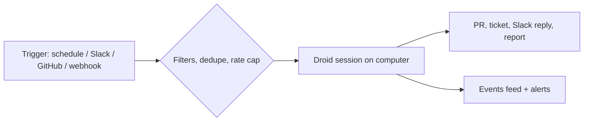

# Custom Automations

> [[raw/docs/llms-docs-factory-com/software-factory-automations|Raw]] · llms-txt · Factory docs, Software Factory

## Summary

This page documents Factory's automations: each one starts a Droid (Factory's agent) session when a trigger fires. Triggers are a schedule, a top-level Slack message, a GitHub event, or an inbound HTTP `POST` to a per-automation webhook URL. An automation is defined by its trigger, a prompt with optional model and reasoning level, a run identity (yourself or a shared service account), a compute target (a Droid Computer, your own machine via the desktop app, or GitHub Actions), and visibility. [[raw/docs/llms-docs-factory-com/software-factory-automations#what-an-automation-is|cite]]

Creation has four routes: ready-made starters (Ticket to PR, PR Reviewer, Error Triage, Alert Responder, CI Failure Triage and others), guided setups (Triage, PR Babysitter, Incident Response, Code Review, QA, AutoWiki, Security Audit), blank custom automations, or "Create with Droid", where a chat session drafts the automation through CreateAutomation, ListAutomations, ReadAutomation, EditAutomation and DeleteAutomation tools. [[raw/docs/llms-docs-factory-com/software-factory-automations#create-an-automation|cite]] [[raw/docs/llms-docs-factory-com/software-factory-automations#create-automations-from-a-droid-session|cite]]

A large share of the page is operations: webhook credentials and delivery statuses, run health, automatic pauses, and alerting. A scheduled automation is a folder on its computer, with instructions in `HEARTBEAT.md`, a `VISUAL.html` dashboard, `memory/`, `reports/` and `skills/`.

## Key claims

- Webhook automations authenticate with an `X-Webhook-Secret` header or a `secret` query parameter. The secret is shown once, and only a hash is stored. Rotating it invalidates the old one at once. [[raw/docs/llms-docs-factory-com/software-factory-automations#webhook-url-and-secret|cite]]
- Webhook intake limits: 200 KiB body, 60 accepted requests per minute per URL, identical bodies deduped for 10 minutes, 10 runs per hour per automation. [[raw/docs/llms-docs-factory-com/software-factory-automations#webhook-url-and-secret|cite]] [[raw/docs/llms-docs-factory-com/software-factory-automations#review-deliveries|cite]]
- An optional JavaScript regex payload filter decides which deliveries start a run. Each delivery is logged as Dispatched, Filtered, Deduped, Rate-capped, Skipped or Failed, and records are kept 30 days. [[raw/docs/llms-docs-factory-com/software-factory-automations#filter-which-deliveries-start-a-run|cite]]
- Slack automations trigger only on top-level messages, support `*` channel patterns, sender and keyword filters, and always reply as Factory. [[raw/docs/llms-docs-factory-com/software-factory-automations#slack-channels-and-messages|cite]]
- Custom GitHub automations run in GitHub Actions, and their workflow file must be merged to the default branch through a setup pull request before they work. [[raw/docs/llms-docs-factory-com/software-factory-automations#github-events|cite]]
- Factory pauses an automation after five failed scheduled runs, 10 days of missed runs, or a computer over capacity (more than 10 automations, or more than 5 in the same minute). [[raw/docs/llms-docs-factory-com/software-factory-automations#automatic-pauses|cite]]
- Prompt text in `HEARTBEAT.md` is capped at 256 KiB. Factory never truncates it; an over-limit automation keeps its last accepted prompt. [[raw/docs/llms-docs-factory-com/software-factory-automations#prompt-size-limit|cite]]

## Notable quotes

> "Automations turn Droid into a teammate for work that keeps coming back."
> — [[raw/docs/llms-docs-factory-com/software-factory-automations#custom-automations|intro]]

> "Runs are told not to edit `HEARTBEAT.md` unless its instructions say to, because anything written there becomes an instruction for every later run."
> — [[raw/docs/llms-docs-factory-com/software-factory-automations#prompt-size-limit|Prompt size limit]]

## Connections

- **Entities**: [[wiki/entities/github]], [[wiki/entities/slack]], [[wiki/entities/linear]], [[wiki/entities/jira]], [[wiki/entities/gitlab]], [[wiki/entities/sentry]]
- **Concepts**: [[wiki/concepts/webhook]], [[wiki/concepts/mcp]]

> Synthesis: Factory's counterpart to Warp factories automations and 8090 automations modules; unusual for its detailed webhook delivery semantics and per-automation folder state.
