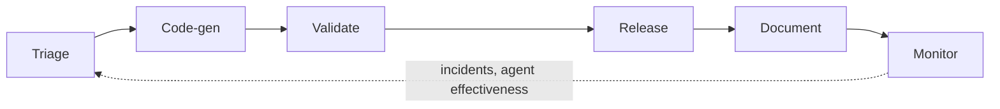

# Software Factory

> [[raw/docs/llms-docs-factory-com/software-factory-overview|Raw]] · llms-txt · Factory docs, Software Factory

## Summary

This page introduces Software Factory in the Factory App: "a 24/7 autonomous system that connects AI agents across the software development lifecycle, from intake and triage through planning, execution, validation, shipping, monitoring, and recurring automation." It is in Private Preview, with access by request. [[raw/docs/llms-docs-factory-com/software-factory-overview#software-factory|cite]]

The product is framed as a single place to track that system, not as an agent runner. It shows live metrics, connected integrations, repository coverage, stage health and persistent automations. The SDLC is split into six stages: Triage, Code-gen, Validate, Release, Document (via AutoWiki) and Monitor. Each stage has templates and automations, and a stage page shows what is connected and what is missing. [[raw/docs/llms-docs-factory-com/software-factory-overview#what-software-factory-is|cite]]

The dashboard doubles as a coverage map. Users filter by time range and by integration (GitHub, Slack, Linear, GitLab), open a stage, and create missing automations there or on the Automations page. Direct delegation from Linear, Jira or Microsoft Teams is separate and needs no Software Factory automation. [[raw/docs/llms-docs-factory-com/software-factory-overview#manage-coverage-across-the-sdlc|cite]]

## Key claims

- Each stage maps to templates and a coverage type: Validate (Code Review, QA, Security Audit) and Document (AutoWiki) show repository coverage; Code-gen (Slack and Linear delegation) shows integration coverage; Monitor (Incident Response, Agent Effectiveness) shows incident and efficiency coverage. [[raw/docs/llms-docs-factory-com/software-factory-overview#manage-coverage-across-the-sdlc|cite]]
- Four headline metrics: Tickets Triaged, PR Validations, PRs Merged, Incidents Processed. [[raw/docs/llms-docs-factory-com/software-factory-overview#automation-metrics|cite]]
- Stage metrics include throughput and backlog (Triage), lines changed and session output via Droid (Code-gen), pass rate and review volume (Validate), deployments and cycle time (Release), and docs updated (Document). [[raw/docs/llms-docs-factory-com/software-factory-overview#stage-metrics|cite]]
- Health and coverage signals are stage health, repository coverage, integration coverage and setup gaps. [[raw/docs/llms-docs-factory-com/software-factory-overview#health-and-coverage|cite]]
- Monitor connects incidents, alerts and agent effectiveness (including token efficiency) back to engineering work. [[raw/docs/llms-docs-factory-com/software-factory-overview#what-software-factory-is|cite]]

## Notable quotes

> "Software Factory is a 24/7 autonomous system that connects AI agents across the software development lifecycle, from intake and triage through planning, execution, validation, shipping, monitoring, and recurring automation."
> — [[raw/docs/llms-docs-factory-com/software-factory-overview#software-factory|Software Factory]]

## Connections

- **Entities**: [[wiki/entities/github]], [[wiki/entities/gitlab]], [[wiki/entities/jira]], [[wiki/entities/linear]], [[wiki/entities/microsoft-teams]], [[wiki/entities/slack]]
- **Concepts**: [[wiki/concepts/software-factory]]

> Synthesis: Product-docs view of a software factory as an observable coverage map over the SDLC (stage health, repo coverage, setup gaps) rather than a build recipe; a vendor-specific counterpart to the 8090 and Mastra factory docs.
