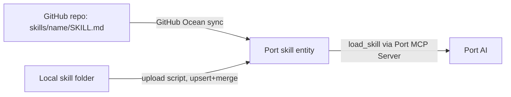

# Skills

> [[raw/docs/llms-docs-port-io/agent-management-skills-overview|Raw]] · llms-txt · https://docs.port.io/agent-management/skills/overview.md

## Summary

Port documents its "skills" feature (open beta, GA expected Q4 2026) as domain-specific guidance packages for Port AI. When a task matches a skill's description, the AI loads the skill's step-by-step instructions so complex but common work is handled consistently. A skill has a name, a description (the trigger), markdown instructions, and optional references and assets. Port says skills follow the open Agent Skills specification. [[raw/docs/llms-docs-port-io/agent-management-skills-overview#What are skills|cite]]

Skills are not files on disk but entities of a user-created `skill` blueprint in Port's catalog. Loading goes through a `load_skill` tool in the Port MCP server, either for the skill or for one named resource (for example `references/common-errors.md`). [[raw/docs/llms-docs-port-io/agent-management-skills-overview#How skills work|cite]] Port ships built-in skills (permissions helper, dashboard helper, Engineering Intelligence setup, mapping assistant, integration and SCIM troubleshooting, workflows, skill-creator). Custom skills with the same identifier override built-ins. [[raw/docs/llms-docs-port-io/agent-management-skills-overview#Priority and overriding|cite]]

Skills reach Port three ways: manual or API entity creation, GitOps via the GitHub Ocean integration (a `skill` kind for SKILL.md only, or a `file` kind that also merges `references/` and `assets/`), or an upload script (Python, JavaScript, Bash) that reads a skill folder and upserts the entity. The page ends with authoring advice.

## Key claims

- A skill is name + description + instructions, plus optional references and assets, following the Agent Skills spec. [[raw/docs/llms-docs-port-io/agent-management-skills-overview#What are skills|cite]]
- Skills load through the `load_skill` tool of the Port MCP Server; Port AI loads one automatically when the task matches the description. [[raw/docs/llms-docs-port-io/agent-management-skills-overview#How skills work|cite]]
- Custom skills are catalog entities and take priority over built-in skills of the same identifier. [[raw/docs/llms-docs-port-io/agent-management-skills-overview#Priority and overriding|cite]]
- With the GitHub integration, pick either the `skill` kind or the `file` kind, not both; keep `deleteDependentEntities: false` so a transient sync failure does not delete skill entities. [[raw/docs/llms-docs-port-io/agent-management-skills-overview#Common practices|cite]]
- With the file kind, each extra-file event replaces the whole `references` or `assets` array, so multi-file directories should use the folder upload script. [[raw/docs/llms-docs-port-io/agent-management-skills-overview#Common practices|cite]]
- Keep instructions under about 5000 tokens (about 500 lines); move detail to references and assets, loaded on demand. [[raw/docs/llms-docs-port-io/agent-management-skills-overview#Keep instructions concise|cite]]

## Notable quotes

> "Instead of relying on general AI capabilities, skills encode expert knowledge into reusable instruction sets that guide the AI through specific processes."
> — [[raw/docs/llms-docs-port-io/agent-management-skills-overview#What are skills|What are skills]]

> "Skills are loaded into the AI's context, so keep instructions under 5000 tokens (approximately 500 lines)."
> — [[raw/docs/llms-docs-port-io/agent-management-skills-overview#Keep instructions concise|Keep instructions concise]]

## Connections

- **Entities**: [[wiki/entities/github]]
- **Concepts**: [[wiki/concepts/agent-skill]], [[wiki/concepts/mcp]]

> Synthesis: Port's variant of the agent-skill pattern is catalog-resident and served over MCP rather than read from a local `.agents/skills` folder, but it keeps the same SKILL.md folder layout and adds GitOps sync.
