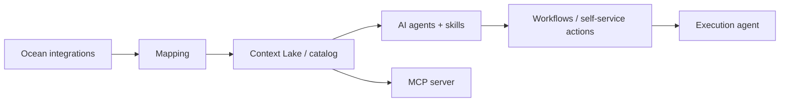

# Glossary

> [[raw/docs/llms-docs-port-io/glossary|Raw]] · llms-txt · Port docs, glossary

## Summary

The glossary defines Port's vocabulary and flags where Port terms collide with industry usage. Its "Start here" block frames the product: an **AI software factory** is the system you build to run the **agentic SDLC**, with agents doing spec, plan, build and test while people set intent, review, and own the deploy decision. The page says "software factory" in these docs is shorthand for the same thing, and differs from the older sense of an outsourced development shop. [[raw/docs/llms-docs-port-io/glossary#ai-software-factory|cite]] [[raw/docs/llms-docs-port-io/glossary#software-factory|cite]]

The substrate is the **Context Lake**: an aggregation layer of catalog data, events and metadata that gives agents organizational context. The catalog is built from **blueprints** (schemas, like class definitions), **entities** (instances), **relations**, **properties**, and **scorecards** (levels and rules for maturity and compliance). Data enters through **Ocean**-based **integrations**, configured by JQ **mapping**. [[raw/docs/llms-docs-port-io/glossary#context-lake|cite]] [[raw/docs/llms-docs-port-io/glossary#blueprint|cite]]

The agent-facing side: Port AI agents, **skills** agents can invoke, an **MCP server** exposing the catalog and actions to external tools, MCP connectors routing external MCP servers through a governed gateway, and a non-AI **execution agent** that relays webhooks into private networks. Much of the page is disambiguation (environment, provider, secret, connector, plugin, workflow, kind).

## Key claims

- The agentic SDLC is the process; the software factory is what you build in Port to run it. [[raw/docs/llms-docs-port-io/glossary#agentic-sdlc|cite]]
- The Context Lake collects catalog data, events and metadata so agents know your services and relationships. [[raw/docs/llms-docs-port-io/glossary#context-lake|cite]]
- Port's MCP server gives external tools (Claude, Cursor, GitHub Copilot) live catalog access and the ability to trigger actions. [[raw/docs/llms-docs-port-io/glossary#mcp-server|cite]]
- A Skill is a reusable AI capability registered once in Port and callable by any agent with access. [[raw/docs/llms-docs-port-io/glossary#skill|cite]]
- Automations fire on catalog events; self-service actions are user-triggered; a Workflow sequences steps, actions, conditions and loops. [[raw/docs/llms-docs-port-io/glossary#automation|cite]] [[raw/docs/llms-docs-port-io/glossary#workflow|cite]]
- The execution agent (`port-agent`) has no AI; it relays webhook calls over Kafka to private services. [[raw/docs/llms-docs-port-io/glossary#execution-agent|cite]]

## Notable quotes

> "The software development lifecycle when AI agents carry out its stages - spec, plan, build, test - while people set the intent, review the work, and own the decision to deploy."
> — [[raw/docs/llms-docs-port-io/glossary#agentic-sdlc|Agentic SDLC]]

## Connections

- **Entities**: none
- **Concepts**: [[wiki/concepts/software-factory]], [[wiki/concepts/mcp]], [[wiki/concepts/agent-skill]]

> Synthesis: Vendor definitions page that casts a catalog-centric internal developer portal as a software factory, with the Context Lake as its shared knowledge layer; compare with Warp and 8090 framings.
