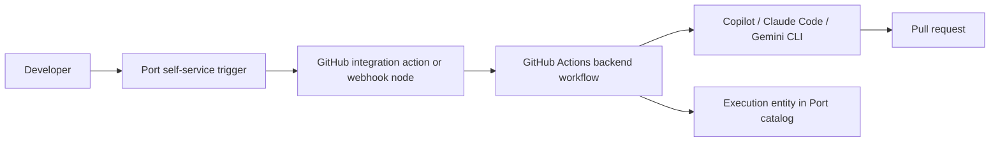

# Trigger AI coding assistants from Port

> [[raw/docs/llms-docs-port-io/guides-all-trigger-ai-coding-assistants-from-port|Raw]] · llms-txt

## Summary

A step-by-step guide for making Port the governed entry point for AI coding work. A developer submits a request (prompt plus target service, or a GitHub issue) in a Port workflow. The workflow hands off to GitHub, where the assistant runs, opens a pull request, and reports back into the Port catalog. Three assistants are covered in separate tabs: GitHub Copilot, Claude Code and Google Gemini Assistant (Gemini CLI). [[raw/docs/llms-docs-port-io/guides-all-trigger-ai-coding-assistants-from-port#How it works|cite]]

The architecture is the same each time. A Port workflow chains a self-service trigger node with either a GitHub integration action that dispatches a GitHub Actions workflow, or a webhook node that calls the GitHub API directly. The backend GitHub Actions workflow "continues to do the heavy lifting"; Port replaces only the old self-service actions and automations that triggered it. [[raw/docs/llms-docs-port-io/guides-all-trigger-ai-coding-assistants-from-port#How it works|cite]]

## Key claims

- Copilot uses issue-driven assignment. A webhook node creates the issue, an `auto_assign` label marks it, and an event-triggered workflow on `githubIssue` updates dispatches `assign_to_copilot.yml`, which finds the `copilot-swe-agent` bot via GraphQL and assigns it. [[raw/docs/llms-docs-port-io/guides-all-trigger-ai-coding-assistants-from-port#Auto-assign issues to Copilot workflow|cite]]
- Claude Code runs through `anthropics/claude-code-base-action@beta` in a dedicated backend repo. The action receives a restricted tool list (`Bash,Edit,Write,GlobTool,GrepTool,BatchTool`) and a system prompt forbidding changes to main except via a PR on a new branch. [[raw/docs/llms-docs-port-io/guides-all-trigger-ai-coding-assistants-from-port#Add the backend GitHub workflow|cite]]
- Claude runs are tracked as `claudeCodeExecution` entities holding prompt, status, execution time, input/output tokens, total USD cost and response, related to a service and an `ai_coding_agent`. [[raw/docs/llms-docs-port-io/guides-all-trigger-ai-coding-assistants-from-port#Create Claude Code execution blueprint|cite]]
- The Gemini variant uses `google-github-actions/run-gemini-cli`, with `maxSessionTurns` 30, a 10-minute timeout, an allowlist of GitHub MCP tools and a shell allowlist (`cat`, `echo`, `grep`, `head`, `tail`). Its execution entity records no token or cost data, and `executionTime` is hard-coded to 0. [[raw/docs/llms-docs-port-io/guides-all-trigger-ai-coding-assistants-from-port#Add the backend GitHub workflow|cite]]
- Credentials sit in both GitHub secrets (`PORT_CLIENT_ID`, `PORT_CLIENT_SECRET`, `PORT_GITHUB_TOKEN`, plus `ANTHROPIC_API_KEY` or `GEMINI_API_KEY`) and Port secrets. The guide recommends a GitHub machine user for commit attribution. [[raw/docs/llms-docs-port-io/guides-all-trigger-ai-coding-assistants-from-port#Add secrets|cite]]

## Notable quotes

> "The backend GitHub Actions workflows continue to do the heavy lifting. The Port workflow replaces the self-service actions and automations that used to trigger them."
> — [[raw/docs/llms-docs-port-io/guides-all-trigger-ai-coding-assistants-from-port#How it works|How it works]]

> "Do NOT make any changes directly to main EVER, only through a PR via a new branch."
> — [[raw/docs/llms-docs-port-io/guides-all-trigger-ai-coding-assistants-from-port#Add the backend GitHub workflow|Claude backend workflow]]

## Connections

- **Entities**: [[wiki/entities/port]], [[wiki/entities/github]], [[wiki/entities/claude-code]]
- **Concepts**: [[wiki/concepts/agentops]], [[wiki/concepts/webhook]]

> Synthesis: A concrete recipe for the "agents as platform components" role in Port's agent-management docs: governance and cost visibility live in the catalog, while GitHub Actions is the runner; Claude Code is the only variant with token and cost tracking.
