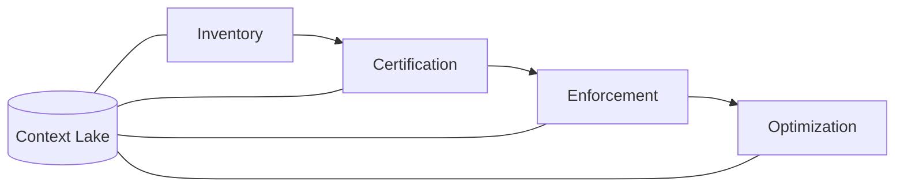

# AgentOps

> [[raw/docs/llms-docs-port-io/solutions-agentops-overview|Raw]] · llms-txt

## Summary

This is the overview of Port's AgentOps solution. AgentOps is defined as the practice of creating, running and operating AI agents and their dependent assets (agents, skills, MCP servers, plugins) reliably and at scale. Port positions itself as the management layer above agent platforms, repositories and AI gateways, covering Claude managed agents, AWS Bedrock, Azure AI Foundry, Cursor, n8n and repos full of `SKILL.md` files. [[raw/docs/llms-docs-port-io/solutions-agentops-overview#AgentOps|cite]]

The page argues from a problem: "agentic sprawl". Skills get copied and forked, agents run on personal tokens in CI jobs or n8n, MCP servers expose every tool by default, and costs are invisible. Organizations then fail in one of three ways: too loose, too slow or too wasteful. [[raw/docs/llms-docs-port-io/solutions-agentops-overview#The problem: agentic sprawl|cite]]

It ties this to the software factory: at the "AI-autonomous" maturity level the SDLC becomes a factory where agents triage, code, review and handle incidents while humans approve key decisions. The page uses a machine-on-the-line metaphor to justify governance of each agent. [[raw/docs/llms-docs-port-io/solutions-agentops-overview#How AgentOps feeds the software factory|cite]]

## Key claims

- Three maturity levels (AI-assisted, AI-led, AI-autonomous) each bring a new sprawl; AgentOps starts at level 1 and underlies all levels. [[raw/docs/llms-docs-port-io/solutions-agentops-overview#When you need AgentOps|cite]]
- Four practices, each building on the last, all on Port's Context Lake: Inventory (one registry with owners, permissions, dependencies), Certification (scorecards, golden paths, promotion gates), Enforcement (ownership, non-human identity, guardrails, audit, kill switch), Optimization (self-improvement routines, ROI tracking). [[raw/docs/llms-docs-port-io/solutions-agentops-overview#The four AgentOps practices|cite]]
- Factory-grade agents must be registered, owned, scoped to what they need, audited and stoppable, with scoped access instead of a developer's full permissions. [[raw/docs/llms-docs-port-io/solutions-agentops-overview#How AgentOps feeds the software factory|cite]]
- Agents, skills, MCP servers, tools, teams, services and permissions are modeled as one dependency graph; MCP servers connect through MCP connectors. [[raw/docs/llms-docs-port-io/solutions-agentops-overview#Why Port|cite]]
- Cites Gartner: over 40% of agentic AI projects will be canceled by end of 2027, inadequate risk controls among the reasons. [[raw/docs/llms-docs-port-io/solutions-agentops-overview#When you need AgentOps|cite]]

## Notable quotes

> "A machine is certified before it joins the line. Agents pass promotion gates before they reach production."
> — [[raw/docs/llms-docs-port-io/solutions-agentops-overview#How AgentOps feeds the software factory|How AgentOps feeds the software factory]]

> "Port is the management layer above your agent platforms, repositories and AI gateways."
> — [[raw/docs/llms-docs-port-io/solutions-agentops-overview#The goal: run agents safely in your production SDLC|The goal]]

## Connections

- **Entities**: none
- **Concepts**: [[wiki/concepts/software-factory]], [[wiki/concepts/agent-skill]], [[wiki/concepts/mcp]], [[wiki/concepts/human-in-the-loop]], [[wiki/concepts/control-plane]], [[wiki/concepts/knowledge-graph]]

> Synthesis: A vendor-neutral governance layer (registry, certification, kill switch) around the factory's agents, where the Warp and 8090 docs describe the factory itself; Port's own pitch is product-led and unverified.
