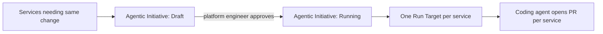

# Agentic initiatives

> [[raw/docs/llms-docs-port-io/solutions-autonomous-ticket-resolution-agentic-initiatives|Raw]] · llms-txt · Port docs, Autonomous Ticket Resolution (ATR)

## Summary

This page introduces "agentic initiatives", a Port pattern that inverts the usual ATR flow. Most ATR patterns act on one ticket at a time; an initiative starts from one change many services need and fans a coding agent out across all of them in a single governed run. The instruction is held once, and each touched service becomes its own tracked run with its own pull request, status and approval path. [[raw/docs/llms-docs-port-io/solutions-autonomous-ticket-resolution-agentic-initiatives#agentic-initiatives|cite]]

The natural trigger is a scorecard rule such as "every service has a CODEOWNERS file". The catalog already evaluates it continuously, so the list of failing services is the target list, with no separate backlog. The motivating problem is standards drift: services are compliant at creation and nobody owns re-checking, so "14 services missing CODEOWNERS" must become 14 PRs without a day of manual work. [[raw/docs/llms-docs-port-io/solutions-autonomous-ticket-resolution-agentic-initiatives#the-problem-it-solves|cite]]

The page also positions initiatives against sibling patterns: reactive self-heal on scorecard degradation, routing failures to Jira tickets, and delegating a single enriched ticket. It says these compose. [[raw/docs/llms-docs-port-io/solutions-autonomous-ticket-resolution-agentic-initiatives#when-to-use-this|cite]]

## Key claims

- The trigger is a set (scorecard rule, catalog query or hand-picked list), not a single item. [[raw/docs/llms-docs-port-io/solutions-autonomous-ticket-resolution-agentic-initiatives#the-mental-model|cite]]
- An `agentic_initiative` entity is one fix effort; each service becomes a `run_target` entity with its own status, PR and CI result, and the initiative rolls these up into live counts. [[raw/docs/llms-docs-port-io/solutions-autonomous-ticket-resolution-agentic-initiatives#the-mental-model|cite]]
- The initiative's `approval_policy` can route by service criticality: auto-merge for low-risk services, a human checkpoint for tier-1. [[raw/docs/llms-docs-port-io/solutions-autonomous-ticket-resolution-agentic-initiatives#the-mental-model|cite]]
- Tracked states per fix are pending, running, PR opened, merged, failed; one run can cover two services or two hundred. [[raw/docs/llms-docs-port-io/solutions-autonomous-ticket-resolution-agentic-initiatives#the-problem-it-solves|cite]]
- A service added later is flagged by the same scorecard, so the next initiative includes it automatically. [[raw/docs/llms-docs-port-io/solutions-autonomous-ticket-resolution-agentic-initiatives#the-problem-it-solves|cite]]

## Notable quotes

> "Same agent, same instruction, different gate per service."
> — [[raw/docs/llms-docs-port-io/solutions-autonomous-ticket-resolution-agentic-initiatives#the-mental-model|The mental model]]

## Connections

- **Entities**: none linked.
- **Concepts**: [[wiki/concepts/human-in-the-loop]]

> Synthesis: Port's fleet-wide, scorecard-driven take on agent fan-out; the criticality-routed approval gate is a concrete human-in-the-loop design, and the run-target tracking resembles multi-repo coordination.
