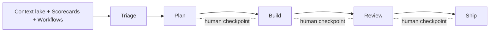

# Autonomous ticket resolution

> [[raw/docs/llms-docs-port-io/solutions-autonomous-ticket-resolution-overview|Raw]] · llms-txt · Port docs, Solutions

## Summary

This is the overview page for Port's "Autonomous Ticket Resolution" (ATR) pattern. Its premise: with AI writing code, the bottleneck is the work before and after coding, namely assembling context, routing, risk review and deploy approval. AI can produce about 80% of a feature fast; the remaining 20% (routing decisions, edge cases, missing context) is where delivery stalls. [[raw/docs/llms-docs-port-io/solutions-autonomous-ticket-resolution-overview#autonomous-ticket-resolution|cite]]

ATR splits the SDLC into five stages, Triage, Plan, Build, Review, Ship, and lets each team decide how far to automate each one. Human checkpoints are drawn at Plan, Build and Review. The page contrasts "without Port" (ticket with no owner or scope, informal routing, manual deploys, no AI metrics) against "with Port" (enriched work items, deterministic scorecard routing, PRs enriched before review, deployment gates, an ROI dashboard). [[raw/docs/llms-docs-port-io/solutions-autonomous-ticket-resolution-overview#what-breaks-without-a-platform|cite]]

Every stage is composed from three building blocks: a context lake (the software catalog linking tickets, services, teams, repos, ownership), scorecards (platform-defined rules gating transitions) and workflows (orchestrating agents, humans and tools). Port does not prescribe the exact workflow. The rest of the page is a link index to guides per stage.

## Key claims

- AI compresses implementation unevenly: work that took weeks takes hours, while requirements, routing and verification stay human-paced. [[raw/docs/llms-docs-port-io/solutions-autonomous-ticket-resolution-overview#what-breaks-without-a-platform|cite]]
- Agents fail because context is wrong, not because the model is wrong; the catalog supplies ownership, dependencies and incidents instead of "five separate API calls". [[raw/docs/llms-docs-port-io/solutions-autonomous-ticket-resolution-overview#how-port-makes-it-work|cite]]
- Scorecards make routing, review approval and deployment readiness deterministic and auditable. [[raw/docs/llms-docs-port-io/solutions-autonomous-ticket-resolution-overview#how-port-makes-it-work|cite]]
- The reference first workflow runs Jira ticket, catalog enrichment, AI readiness scoring, Slack approval, then Cursor delegation; other guides delegate Jira tickets to Claude Code or GitHub Copilot via Port-native orchestration or n8n. [[raw/docs/llms-docs-port-io/solutions-autonomous-ticket-resolution-overview#next-steps|cite]] [[raw/docs/llms-docs-port-io/solutions-autonomous-ticket-resolution-overview#start-building|cite]]
- "Agentic initiatives" fan one coding agent out across every service failing a scorecard rule, tracked as a single initiative. [[raw/docs/llms-docs-port-io/solutions-autonomous-ticket-resolution-overview#next-steps|cite]]
- Vendor-reported outcomes: 40-45% of engineering tasks automated and 20%+ developer productivity gains. [[raw/docs/llms-docs-port-io/solutions-autonomous-ticket-resolution-overview#how-port-makes-it-work|cite]]

## Notable quotes

> "In an AI-assisted SDLC, the developer's primary output is not code. It's the system that produces code."
> — [[raw/docs/llms-docs-port-io/solutions-autonomous-ticket-resolution-overview#how-port-makes-it-work|How Port makes it work]]

> "Platform teams define the rules. Engineers and agents consume them."
> — [[raw/docs/llms-docs-port-io/solutions-autonomous-ticket-resolution-overview#how-port-makes-it-work|How Port makes it work]]

## Connections

- **Entities**: [[wiki/entities/jira]], [[wiki/entities/slack]], [[wiki/entities/claude-code]]
- **Concepts**: [[wiki/concepts/human-in-the-loop]], [[wiki/concepts/context-engineering]]

> Synthesis: Port frames the factory as catalog context plus deterministic scorecard gates around third-party coding agents (an orchestration layer, not an agent harness); the 40-45% figures are vendor claims.
