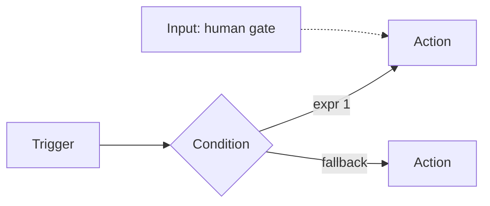

# Concepts and structure

> [[raw/docs/llms-docs-port-io/workflows-concepts|Raw]] · llms-txt · https://docs.port.io/workflows/concepts.md

## Summary

This Port docs page defines the building blocks of Port workflows. A workflow is a directed graph: nodes do the work, connections set execution order, and data flows from node to node. [[raw/docs/llms-docs-port-io/workflows-concepts#nodes|cite]]

There are four node types. A trigger is the entry point (self-service/manual, event on entity change, or cron schedule). An action sends a webhook, upserts an entity, publishes to Kafka, triggers an integration action, or invokes AI. A condition routes to branches by JQ expressions. An input node pauses the run until a human responds, for approvals and manual gates. A workflow may have several triggers sharing the same downstream logic.

A workflow is plain JSON (identifier, title, icon, description, category, `nodes`, `connections`). It is versioned with `workflowVersionIdentifier`, so UI and API edits do not silently overwrite each other. This makes workflows definable and updatable as code through the API.

## Key claims

- Four node types exist: trigger, action, condition, input. [[raw/docs/llms-docs-port-io/workflows-concepts#nodes|cite]]
- Multiple triggers (any mix of self-service, event, schedule) can feed one workflow. Only the fired trigger produces outputs, reachable as `.outputs["<id>"]` or the alias `.outputs.trigger`. Self-service permissions are set per trigger node. [[raw/docs/llms-docs-port-io/workflows-concepts#multiple-triggers|cite]]
- Condition nodes evaluate JQ expressions; the first match wins, else a fallback path runs. [[raw/docs/llms-docs-port-io/workflows-concepts#conditions|cite]]
- Input nodes pause a workflow for a human response. [[raw/docs/llms-docs-port-io/workflows-concepts#nodes|cite]]
- `PUT /v1/workflows/{id}` with an `If-Match` header carrying `workflowVersionIdentifier` returns `412` / `workflow_version_conflict` on a stale version. Omitting the header overwrites unconditionally. [[raw/docs/llms-docs-port-io/workflows-concepts#via-the-api|cite]]
- The UI shows a "Workflow was modified" dialog with Overwrite, Revert, Cancel. [[raw/docs/llms-docs-port-io/workflows-concepts#in-the-ui|cite]]

## Notable quotes

> "Input: Pauses the workflow and waits for a human response before continuing. Use for approvals, manual gates, and decision points."
> — [[raw/docs/llms-docs-port-io/workflows-concepts#nodes|Nodes]]

## Connections

- **Entities**: none yet (Port itself is a suggested new entity).
- **Concepts**: [[wiki/concepts/human-in-the-loop]], [[wiki/concepts/factory-as-code]]

> Synthesis: Port frames automation as a JSON workflow graph with explicit human-approval nodes, a close parallel to the automation and approval gates in other factory products in this wiki.
