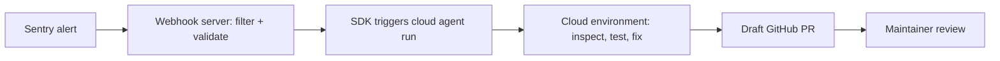

# Demo: Sentry monitoring with SDK

> [[raw/docs/llms-docs-warp-dev/factories-api-and-sdk-demo-sentry-monitoring-with-sdk|Raw]] · llms-txt

## Summary

The docs describe a small TypeScript "Sentry monitor" service that converts specific Sentry alerts (example given: a Go nil pointer dereference) into draft pull requests. The service validates the incoming webhook, extracts the stack trace, and injects it into a Warp cloud agent run, so the agent can inspect the repo and propose a fix. [[raw/docs/llms-docs-warp-dev/factories-api-and-sdk-demo-sentry-monitoring-with-sdk#Demo: Sentry monitoring with SDK|cite]]

The page is a short pointer to a demo video and an example repository, not a tutorial. It states the demo covers standalone cloud agent intake: to route an alert through a factory's agents and workflow, the docs say to use factory endpoints or a custom webhook instead. [[raw/docs/llms-docs-warp-dev/factories-api-and-sdk-demo-sentry-monitoring-with-sdk#Demo: Sentry monitoring with SDK|cite]]

## Key claims

- The service uses the TypeScript SDK to trigger agent runs and retrieve run details. [[raw/docs/llms-docs-warp-dev/factories-api-and-sdk-demo-sentry-monitoring-with-sdk#What the demo covers|cite]]
- It handles run lifecycle states (queued to running) to fetch a session link for debugging. [[raw/docs/llms-docs-warp-dev/factories-api-and-sdk-demo-sentry-monitoring-with-sdk#What the demo covers|cite]]
- Agents run inside a cloud environment so they can investigate real code, run tests and validate fixes. [[raw/docs/llms-docs-warp-dev/factories-api-and-sdk-demo-sentry-monitoring-with-sdk#What the demo covers|cite]]
- The webhook server filters, validates and routes only the right errors to an agent. [[raw/docs/llms-docs-warp-dev/factories-api-and-sdk-demo-sentry-monitoring-with-sdk#What the demo covers|cite]]
- The workflow ends in a draft GitHub pull request for a maintainer to review, "instead of silent autonomous changes". [[raw/docs/llms-docs-warp-dev/factories-api-and-sdk-demo-sentry-monitoring-with-sdk#What the demo covers|cite]]
- Full source lives in the warp-agents-sdk-demo-sentry-monitor example repository. [[raw/docs/llms-docs-warp-dev/factories-api-and-sdk-demo-sentry-monitoring-with-sdk#Demo: Sentry monitoring with SDK|cite]]

## Notable quotes

> "Ending the workflow in a draft GitHub pull request for a maintainer to review, instead of silent autonomous changes."
> — [[raw/docs/llms-docs-warp-dev/factories-api-and-sdk-demo-sentry-monitoring-with-sdk#What the demo covers|What the demo covers]]

## Connections

- **Entities**: [[wiki/entities/warp-factories]], [[wiki/entities/sentry]], [[wiki/entities/github]]
- **Concepts**: [[wiki/concepts/webhook]], [[wiki/concepts/human-in-the-loop]]

> Synthesis: Thin vendor demo page; its value is the pattern (alert webhook, filtered intake, agent run, draft PR as a human gate), which sits beside the factory-endpoint and custom-webhook routes the docs prefer for full factories.
