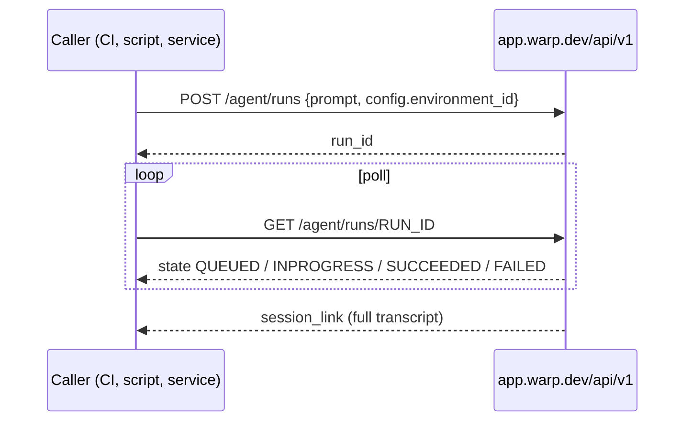

# Warp Platform API quickstart

> [[raw/docs/llms-docs-warp-dev/factories-api-and-sdk-quickstart|Raw]] · llms-txt

## Summary

This is a vendor quickstart. The docs state that the Warp Platform API lets you run and manage cloud agents from CI/CD pipelines, backend services, scripts or custom tooling, without the Warp desktop app. [[raw/docs/llms-docs-warp-dev/factories-api-and-sdk-quickstart#Warp Platform API quickstart|cite]] The goal is a first run created and checked in about five minutes.

The flow is four steps: export an API key, POST a prompt plus an environment ID, poll the run by `run_id`, then open the transcript link. The run starts asynchronously, so the create call returns a `run_id` at once and the caller must poll. [[raw/docs/llms-docs-warp-dev/factories-api-and-sdk-quickstart#2\. Create your first run|cite]]

The docs say this generic run API is the base layer. To dispatch work through a factory's named agents and workflow, you use separate factory endpoints afterward, and the same run-management steps apply to the factory run they create. [[raw/docs/llms-docs-warp-dev/factories-api-and-sdk-quickstart#Warp Platform API quickstart|cite]]

## Key claims

- Prerequisites are a Warp API key and a configured cloud environment with the needed repositories and dependencies. [[raw/docs/llms-docs-warp-dev/factories-api-and-sdk-quickstart#Prerequisites|cite]]
- A personal key attributes runs to the user. An agent key attributes them to a cloud agent. Requests authenticate with `Authorization: Bearer $WARP_API_KEY`. [[raw/docs/llms-docs-warp-dev/factories-api-and-sdk-quickstart#1\. Set your API key|cite]]
- Runs are created with `POST https://app.warp.dev/api/v1/agent/runs`, body `prompt` plus `config.environment_id`. The environment ID comes from `oz environment list` or the Oz web app. [[raw/docs/llms-docs-warp-dev/factories-api-and-sdk-quickstart#2\. Create your first run|cite]]
- Run `state` is `QUEUED`, `INPROGRESS`, `SUCCEEDED` or `FAILED`, described as the most common states. On `FAILED`, `status_message` holds details. `GET /agent/runs` lists recent runs. [[raw/docs/llms-docs-warp-dev/factories-api-and-sdk-quickstart#3\. Check run status|cite]]
- A succeeded run returns a `session_link` to the full transcript: commands executed, files changed, agent output. Runs can also be managed in a cloud agent dashboard. [[raw/docs/llms-docs-warp-dev/factories-api-and-sdk-quickstart#4\. View the results|cite]]
- Official typed SDKs exist: Python `warp-platform-sdk` and TypeScript `@warp-dot-dev/warp-platform-sdk`, with retries and error handling. [[raw/docs/llms-docs-warp-dev/factories-api-and-sdk-quickstart#2\. Create your first run|cite]]

## Notable quotes

> "The Warp Platform API lets you run and manage cloud agents from CI/CD pipelines, backend services, scripts, or custom tooling without the Warp desktop app."
> — [[raw/docs/llms-docs-warp-dev/factories-api-and-sdk-quickstart#Warp Platform API quickstart|intro]]

## Connections

- **Entities**: [[wiki/entities/warp-factories]]
- **Concepts**: [[wiki/concepts/dev-environment]]

> Synthesis: Vendor how-to for the programmatic entry point to Warp's cloud agents; it shows the asynchronous create-then-poll run lifecycle that factory endpoints build on, and says nothing on factory design itself.
