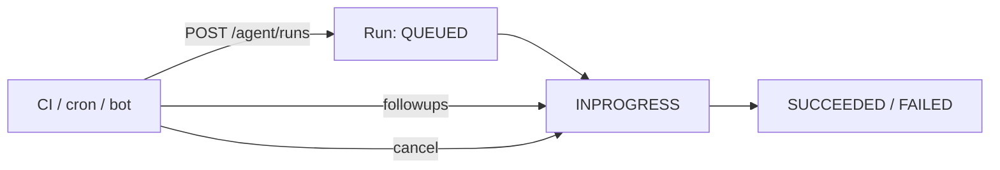

# Agent & run endpoints

> [[raw/docs/llms-docs-warp-dev/factories-api-and-sdk|Raw]] · llms-txt

## Summary

The docs state that the Warp Platform API lets CI, cron jobs, backend services and internal tools start standalone cloud agent runs over HTTP, then monitor, continue or cancel any run, with no Warp desktop app needed. [[raw/docs/llms-docs-warp-dev/factories-api-and-sdk#Use Agent & run endpoints|cite]] Work meant for a Warp factory goes through separate factory endpoints (discover by UID, dispatch); the follow-up, cancel and status endpoints still apply to factory runs afterward. [[raw/docs/llms-docs-warp-dev/factories-api-and-sdk#Use Agent & run endpoints|cite]]

A run is one execution of a cloud agent: `run_id`, `title`, `prompt`, `state` (`QUEUED`, `INPROGRESS`, `SUCCEEDED`, `FAILED`), timestamps, optional session link and resolved `agent_config`. [[raw/docs/llms-docs-warp-dev/factories-api-and-sdk#Agent runs|cite]] Behavior is tuned through `AmbientAgentConfig`: `name`, `model_id`, `base_prompt`, `environment_id`, `worker_host`, `skill_spec` and `mcp_servers`. [[raw/docs/llms-docs-warp-dev/factories-api-and-sdk#Agent configuration|cite]]

Official SDKs (`warp-platform-sdk` on PyPI, `@warp-dot-dev/warp-platform-sdk` on npm) wrap the API with typed models, retries/timeouts and error types. Base URL is `https://app.warp.dev/api/v1`. [[raw/docs/llms-docs-warp-dev/factories-api-and-sdk#Choose the SDK or raw REST|cite]]

## Key claims

- Five endpoints: `POST /agent/runs`, `GET /agent/runs` (filter by state, config_name, model_id, creator, source, time), `GET /agent/runs/{runId}`, `POST .../followups`, `POST .../cancel`. [[raw/docs/llms-docs-warp-dev/factories-api-and-sdk#Key endpoints|cite]]
- The follow-up endpoint is the same capability the Slack and Linear integrations use. [[raw/docs/llms-docs-warp-dev/factories-api-and-sdk#Key endpoints|cite]]
- Setting `worker_host` routes a run to a connected self-hosted worker; omit it or use `warp` for Warp-hosted workers. Factory work sets `workerHost` in the factory definition instead. [[raw/docs/llms-docs-warp-dev/factories-api-and-sdk#Route a run to a self-hosted worker|cite]]
- `skill_spec` uses a skill as base prompt (`owner/repo:skill-name`); runs from a skill get `name` set to the skill name, and `GET /agent/runs` can filter by that name. [[raw/docs/llms-docs-warp-dev/factories-api-and-sdk#Agent configuration|cite]]
- Conversation API reports skill loads as `read_skill` actions; to measure team-owned skill use, exclude `input.bundled_skill_id` and confirm path-only loads belong to a team-managed skill root. [[raw/docs/llms-docs-warp-dev/factories-api-and-sdk#Skill actions in conversation data|cite]]
- Docs list 14 bundled skill IDs (e.g. `oz-platform`, `factory-files`, `factory-mcp`) but say the catalog is not an availability manifest. [[raw/docs/llms-docs-warp-dev/factories-api-and-sdk#Skill actions in conversation data|cite]]

## Notable quotes

> "Use the SDK when you want strong typing, standardized error handling, and easy concurrency patterns."
> — [[raw/docs/llms-docs-warp-dev/factories-api-and-sdk#Choose the SDK or raw REST|SDK vs raw REST]]

## Connections

- **Entities**: [[wiki/entities/warp-factories]], [[wiki/entities/slack]], [[wiki/entities/linear]]
- **Concepts**: [[wiki/concepts/mcp]], [[wiki/concepts/agent-skill]], [[wiki/concepts/self-hosting]], [[wiki/concepts/factory-as-code]], [[wiki/concepts/agent-runner]]

> Synthesis: Vendor reference for the programmatic control surface of Warp Factories; it is the integration layer under the Slack/Linear triggers and the self-hosted worker model described in sibling pages.
