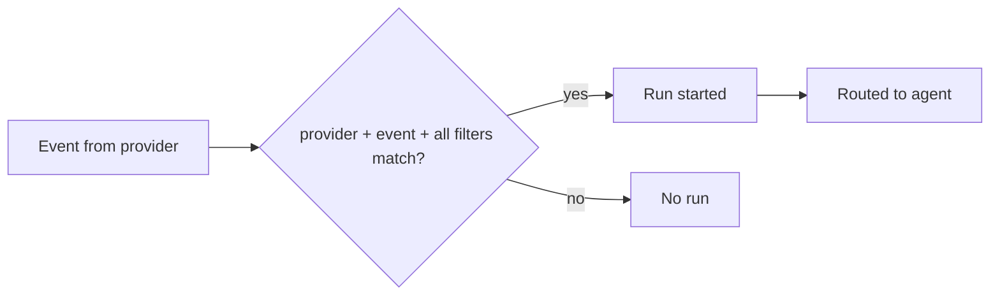

# Factory automations

> [[raw/docs/llms-docs-warp-dev/factories-automations|Raw]] · llms-txt

## Summary

The docs state that an **automation** in [[wiki/entities/warp-factories]] starts factory runs from a trigger and routes them to an agent. Filters narrow which events start work, for example sending only newly opened pull requests on one repository's `main` branch to a review agent. [[raw/docs/llms-docs-warp-dev/factories-automations#Factory automations|cite]]

The page centers on matching semantics: an event starts an automation only if provider, event type and all filters match. Within one filter, any listed value can match. One event can match several automations, and each match starts its own run. It stresses that filters control *when* work starts, not what an integration or running agent can access; access is changed with the provider's permissions, and webhooks authenticate by token or signature. [[raw/docs/llms-docs-warp-dev/factories-automations#How matching works|cite]] [[raw/docs/llms-docs-warp-dev/factories-automations#Filters don’t control access|cite]]

Filters can be edited in the web app's Automations page, or declared in version-controlled definition files (`automation.md` with `triggers` frontmatter). When the definition lives in an external repo, the UI is read-only. A deeper section covers payload filters for custom [[wiki/concepts/webhook]] triggers.

## Key claims

- Every filter must match, any value inside a filter may match, and empty optional list filters do not restrict. GitHub triggers skip bot events by default (`skip_bots` = `all` when omitted). [[raw/docs/llms-docs-warp-dev/factories-automations#How matching works|cite]]
- Filter categories per source: Slack (conversations, people, keywords, emoji), Teams (team, channels, authors, keywords), GitHub (repo, branches, paths, labels, people, reviews, workflow results), GitLab (project, actions, base branch), Azure DevOps (repo, branches, work item types, labels, people), Linear (team, project, issue, labels, state, people), Jira (projects), webhooks (webhook and JSON payload). [[raw/docs/llms-docs-warp-dev/factories-automations#What each source can filter on|cite]]
- In definitions as code, plain lists include values and `not_in` excludes them; the example reviews PRs in `acme/api-service` to `main` excluding label `wip`, with `agent: foreman`. [[raw/docs/llms-docs-warp-dev/factories-automations#Filters in definitions as code|cite]]
- Webhook payload filters match the delivery's JSON body with `in`, `not_in`, `exists`; a missing key fails `in` and passes `not_in`; limits are 10 nesting levels, 64 leaf fields, 32 values per set; contradictory patterns are rejected. [[raw/docs/llms-docs-warp-dev/factories-automations#Payload filter reference|cite]]
- Filters fail closed: a filter that cannot be evaluated never matches. [[raw/docs/llms-docs-warp-dev/factories-automations#Payload filter reference|cite]]
- Troubleshooting: check the automation, connection, access and filters; for webhooks, inspect **Recent deliveries** and use **Test filter** against a stored delivery. [[raw/docs/llms-docs-warp-dev/factories-automations#Troubleshooting|cite]]

## Notable quotes

> "Filters decide when work starts, not what an integration or running agent can access."
> — [[raw/docs/llms-docs-warp-dev/factories-automations#Filters don’t control access|Filters don’t control access]]

> "A filter that can’t be evaluated never matches."
> — [[raw/docs/llms-docs-warp-dev/factories-automations#Payload filter reference|Payload filter reference]]

## Connections

- **Entities**: [[wiki/entities/warp-factories]], [[wiki/entities/github]], [[wiki/entities/slack]], [[wiki/entities/microsoft-teams]], [[wiki/entities/gitlab]], [[wiki/entities/azure-devops]], [[wiki/entities/linear]], [[wiki/entities/jira]]
- **Concepts**: [[wiki/concepts/factory-as-code]], [[wiki/concepts/webhook]]

> Synthesis: Vendor reference for the trigger layer of Warp's factory model; it pairs with the integration and factory-as-code pages, and its fail-closed, overlap-runs-twice semantics matter for any event-driven agent setup.
