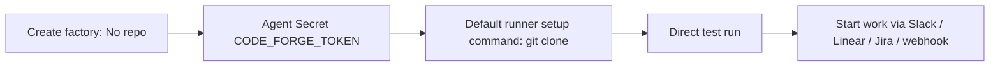

# Connecting other code forges to your factory

> [[raw/docs/llms-docs-warp-dev/factories-code-forges-other-code-forges|Raw]] · llms-txt

## Summary

This Warp Factories docs page covers forges without first-class support: Bitbucket, Azure DevOps Server, self-managed GitLab and similar. The docs state the workaround is to create the factory with no connected repository, then clone the repo yourself from the default runner. [[raw/docs/llms-docs-warp-dev/factories-code-forges-other-code-forges#Connecting other code forges to your factory|cite]]

The flow has four steps. Create the factory with "No repo". Store a repository token as an Agent Secret named `CODE_FORGE_TOKEN`, granted to the agents using the default runner. Add an authenticated `git clone` to the default runner's setup commands, reading `$CODE_FORGE_TOKEN`. Then run a read-only test run. [[raw/docs/llms-docs-warp-dev/factories-code-forges-other-code-forges#Grant the clone credential|cite]]

The docs carry a caution: this gives agents repo access only. No provider-specific events or automations exist for these forges, so work must start from Slack, Linear, Jira, a custom webhook or a direct run. [[raw/docs/llms-docs-warp-dev/factories-code-forges-other-code-forges#Starting work|cite]]

## Key claims

- The docs state hosted Azure DevOps Services repos use the first-class Azure DevOps integration; Azure DevOps Server does not. [[raw/docs/llms-docs-warp-dev/factories-code-forges-other-code-forges#Connecting other code forges to your factory|cite]]
- The docs state the secret is exposed to granted agents and their runner setup commands as the `CODE_FORGE_TOKEN` environment variable, keeping the token out of commands and definition files. [[raw/docs/llms-docs-warp-dev/factories-code-forges-other-code-forges#Grant the clone credential|cite]]
- Runner setup commands prepare each agent workspace before work starts, and run every time a workspace is prepared, so they must be idempotent (the example guards the clone with `if [ ! -d "REPO/.git" ]`). [[raw/docs/llms-docs-warp-dev/factories-code-forges-other-code-forges#Clone the repository from the default runner|cite]]
- Clone format varies by forge; for example Bitbucket Cloud requires the `x-bitbucket-api-token-auth` username. For Azure DevOps Server the docs use an `http.extraheader` Basic auth header built from the token. [[raw/docs/llms-docs-warp-dev/factories-code-forges-other-code-forges#Clone the repository from the default runner|cite]]
- Azure DevOps PAT scope is Code > Read, or Read & Write if agents must push commits. [[raw/docs/llms-docs-warp-dev/factories-code-forges-other-code-forges#Azure DevOps Server credentials|cite]]
- Verification is a direct factory run with a read-only prompt that lists top-level files and reports the current branch. [[raw/docs/llms-docs-warp-dev/factories-code-forges-other-code-forges#Test repository access|cite]]

## Notable quotes

> "This setup gives factory agents repository access. It does not add provider-specific events or automations for the code forge."
> — [[raw/docs/llms-docs-warp-dev/factories-code-forges-other-code-forges#Connecting other code forges to your factory|Caution]]

## Connections

- **Entities**: [[wiki/entities/warp-factories]], [[wiki/entities/azure-devops]], [[wiki/entities/gitlab]], [[wiki/entities/slack]], [[wiki/entities/linear]], [[wiki/entities/jira]]
- **Concepts**: [[wiki/concepts/secrets-management]], [[wiki/concepts/agent-runner]], [[wiki/concepts/webhook]], [[wiki/concepts/self-hosting]]

> Synthesis: Vendor how-to; the escape hatch for unsupported forges trades first-class events for a plain token-plus-clone setup, so these repos can only be driven by other triggers.
