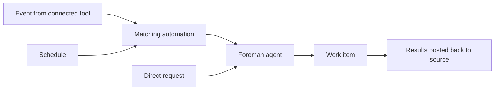

# Connect your factory

> [[raw/docs/llms-docs-warp-dev/factories-connect-your-factory|Raw]] · llms-txt

## Summary

The docs state that a Warp Factory should be wired to the tools where a team already discusses, tracks and reviews work. Wherever work starts, the factory keeps the original context (thread, issue, pull request) and posts results back to the same place. [[raw/docs/llms-docs-warp-dev/factories-connect-your-factory#Connect your factory|cite]]

The page is a routing catalog. Eleven entry points are tabulated with what each is best for, the concrete action that starts work, and where work continues: Slack, Microsoft Teams, GitHub, GitLab, Azure DevOps, Linear, Jira, custom webhooks, factory endpoints (REST), Factory MCP, and direct runs/schedules. [[raw/docs/llms-docs-warp-dev/factories-connect-your-factory#Choose a source|cite]]

Whatever the source, every request lands with a "foreman agent" that turns it into a work item and dispatches the agents each stage needs. Events and schedules first pass through a matching automation. [[raw/docs/llms-docs-warp-dev/factories-connect-your-factory#How work reaches your factory|cite]]

## Key claims

- The docs state GitHub, GitLab.com and Azure DevOps Services connect both repositories and provider-specific work sources; other forges give repository access only, with no provider events or automations. [[raw/docs/llms-docs-warp-dev/factories-connect-your-factory#Connect your factory|cite]]
- Multiple sources may be connected, but not Linear and Jira at once. [[raw/docs/llms-docs-warp-dev/factories-connect-your-factory#Choose a source|cite]]
- A reply in the same thread, issue or PR continues the existing work item; repeated event deliveries do not create duplicates. [[raw/docs/llms-docs-warp-dev/factories-connect-your-factory#How work reaches your factory|cite]]
- The setup wizard adds default automations per connected tool (mentions, assignments, labels, review submitted, PR close/merge follow-up on GitHub; agent sessions for Linear; app mentions for Teams). The docs advise reviewing filters, agent and run settings. [[raw/docs/llms-docs-warp-dev/factories-connect-your-factory#Review the default automations|cite]]
- Custom webhooks give an authenticated URL; an automation filters the payload to decide which deliveries start work. Named examples: CI, PagerDuty, Sentry, Stripe. [[raw/docs/llms-docs-warp-dev/factories-connect-your-factory#Custom webhooks|cite]]
- Factory MCP works in both directions: send work to the factory, or pull a task to a local machine, iterate, and hand it back to the same work item. [[raw/docs/llms-docs-warp-dev/factories-connect-your-factory#Factory MCP|cite]]
- Scheduled automations are markdown files with a cron trigger and a prose prompt, e.g. a Monday 09:00 dependency audit that opens a PR and flags items needing a human decision. [[raw/docs/llms-docs-warp-dev/factories-connect-your-factory#Direct runs and schedules|cite]]

## Notable quotes

> "Wherever work starts, the factory keeps the original context from that source (the thread, issue, or pull request), and posts results in the same place."
> — [[raw/docs/llms-docs-warp-dev/factories-connect-your-factory#Connect your factory|intro]]

## Connections

- **Entities**: [[wiki/entities/warp-factories]], [[wiki/entities/slack]], [[wiki/entities/microsoft-teams]], [[wiki/entities/github]], [[wiki/entities/gitlab]], [[wiki/entities/azure-devops]], [[wiki/entities/linear]], [[wiki/entities/jira]], [[wiki/entities/sentry]]
- **Concepts**: [[wiki/concepts/webhook]], [[wiki/concepts/mcp]], [[wiki/concepts/factory-as-code]], [[wiki/concepts/software-factory]], [[wiki/concepts/human-in-the-loop]]

> Synthesis: Vendor integration catalog, useful as the intake layer of the software-factory idea (many entry points, one foreman, one work item); it describes Warp's design, not independent evidence it works.
