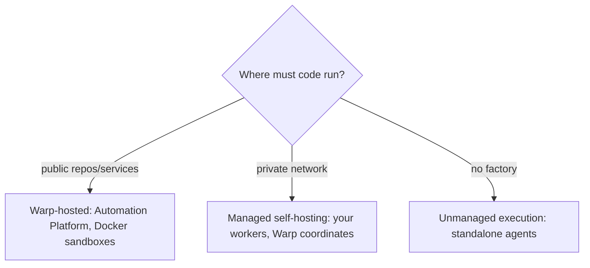

# Deployment patterns for Warp Factories

> [[raw/docs/llms-docs-warp-dev/factories-deployment-patterns|Raw]] · llms-txt

## Summary

The docs state that a factory's execution model is chosen by where its code must run and who operates the compute. Warp-hosted execution is the default; managed self-hosting keeps checkout and command execution inside the customer network while Warp coordinates the work. [[raw/docs/llms-docs-warp-dev/factories-deployment-patterns#Deployment patterns for Warp Factories|cite]]

Both options share the same factory definition, runners and dashboard; only the location of checkout, command execution and the sandbox filesystem changes. A third model, unmanaged execution, is for standalone agents run from CI or developer infrastructure and is explicitly not a factory execution host. [[raw/docs/llms-docs-warp-dev/factories-deployment-patterns#Choose an execution model|cite]]

The page is a short decision guide plus link hub. It points to separate pages for hosting capacity, self-hosting setup, and infrastructure/security boundaries rather than detailing them.

## Key claims

- Warp-hosted execution suits factories that reach repositories and services over the public internet; Warp operates the control plane and per-run sandboxes. [[raw/docs/llms-docs-warp-dev/factories-deployment-patterns#Warp-hosted execution|cite]]
- Hosted agents run in Docker-based environments on the Automation Platform; the factory definition selects agents, runner, workspace and credentials. [[raw/docs/llms-docs-warp-dev/factories-deployment-patterns#What it looks like|cite]]
- Work reaches a factory via automations (integration events, schedules, webhooks), integrations with Slack, Linear, Jira, GitHub and GitLab, factory endpoints dispatching by UID, and Factory MCP for coding agents. [[raw/docs/llms-docs-warp-dev/factories-deployment-patterns#Send work to a factory|cite]]
- Managed self-hosting runs checkout and execution on customer infrastructure while the Automation Platform coordinates and records results; managed workers support Docker, Kubernetes, Direct and external command backends. [[raw/docs/llms-docs-warp-dev/factories-deployment-patterns#Managed self-hosting|cite]]
- Visibility is the same in both: factory dashboard, session sharing and APIs. [[raw/docs/llms-docs-warp-dev/factories-deployment-patterns#What it looks like|cite]]

## Notable quotes

> "Warp-hosted execution is the default. Managed self-hosting keeps checkout and command execution in your network while Warp coordinates the work."
> — [[raw/docs/llms-docs-warp-dev/factories-deployment-patterns#Deployment patterns for Warp Factories|intro]]

## Connections

- **Entities**: [[wiki/entities/warp-factories]], [[wiki/entities/slack]], [[wiki/entities/linear]], [[wiki/entities/jira]], [[wiki/entities/github]], [[wiki/entities/gitlab]], [[wiki/entities/docker]], [[wiki/entities/kubernetes]]
- **Concepts**: [[wiki/concepts/self-hosting]], [[wiki/concepts/control-plane]], [[wiki/concepts/factory-as-code]], [[wiki/concepts/mcp]], [[wiki/concepts/webhook]], [[wiki/concepts/agent-runner]]

> Synthesis: Vendor guidance framing the hosted-versus-self-hosted split as a control-plane/execution-plane boundary; useful as the entry point to Warp's other hosting and security pages.
