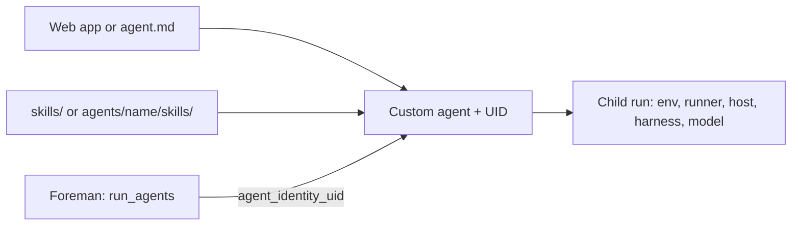

# Creating custom agents

> [[raw/docs/llms-docs-warp-dev/factories-factory-agents-creating-custom-agents|Raw]] · llms-txt

## Summary

The docs state that a custom agent is for work needing its own instructions, configuration and runs, for example a documentation agent that updates reference pages after code changes. [[raw/docs/llms-docs-warp-dev/factories-factory-agents-creating-custom-agents#Creating custom agents|cite]] The page covers two creation paths, skill attachment, and how the foreman picks and launches the agent.

Path depends on factory type. A Warp-managed factory creates the agent in the [[wiki/entities/warp-factories]] web app. A [[wiki/entities/github]]-backed factory defines it in code as `agents/<name>/agent.md` in the definition repository, applied through the repo's normal pull request process. [[raw/docs/llms-docs-warp-dev/factories-factory-agents-creating-custom-agents#Create an agent in the web app|cite]]

## Key claims

- The docs state creation needs Editor access to the factory (or team/workspace admin) and an existing factory. [[raw/docs/llms-docs-warp-dev/factories-factory-agents-creating-custom-agents#Prerequisites|cite]]
- Web app flow: Agents, New, Custom agent; set name and description; choose harness, model, host and runner; add MCP servers and secrets; write the agent prompt; Save. Agent names cannot be changed after creation. [[raw/docs/llms-docs-warp-dev/factories-factory-agents-creating-custom-agents#Create an agent in the web app|cite]]
- Code path: `agents/<name>/agent.md` holds instructions and configuration keys, defined in the factory-as-code docs. [[raw/docs/llms-docs-warp-dev/factories-factory-agents-creating-custom-agents#Define an agent in code|cite]]
- Custom agents have no built-in skills. Skills go in `agents/<name>/skills/` for one agent or `skills/` for all agents. [[raw/docs/llms-docs-warp-dev/factories-factory-agents-creating-custom-agents#Add skills|cite]]
- The foreman dispatches via `run_agents`: it picks from a list of available agents and UIDs, sets `remote` for cloud runs, and passes the UID in `agent_run_configs[].agent_identity_uid`. `name` only labels the child run. [[raw/docs/llms-docs-warp-dev/factories-factory-agents-creating-custom-agents#Dispatch a configured agent|cite]]
- Unless overridden, a run uses the selected agent's environment, runner, host, harness and model. [[raw/docs/llms-docs-warp-dev/factories-factory-agents-creating-custom-agents#Dispatch a configured agent|cite]]
- Child agents can also start without factory config through multi-agent orchestration; scheduled or event-driven work uses factory automations, and the foreman coordinates what they start. [[raw/docs/llms-docs-warp-dev/factories-factory-agents-creating-custom-agents#Dispatch a configured agent|cite]]

## Notable quotes

> "Custom agents have no built-in skills."
> — [[raw/docs/llms-docs-warp-dev/factories-factory-agents-creating-custom-agents#Add skills|Add skills]]

## Connections

- **Entities**: [[wiki/entities/warp-factories]], [[wiki/entities/github]]
- **Concepts**: [[wiki/concepts/factory-as-code]], [[wiki/concepts/agent-skill]], [[wiki/concepts/mcp]], [[wiki/concepts/secrets-management]], [[wiki/concepts/agent-runner]], [[wiki/concepts/agent-harness]]

> Synthesis: Vendor how-to showing a factory agent is a UID-addressed bundle of prompt, harness, model, runner and skills that a foreman dispatches, a concrete instance of the agent-harness and factory-as-code ideas.
