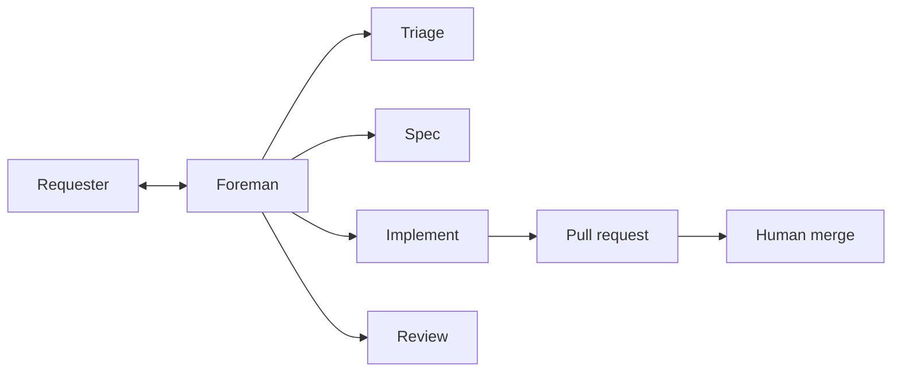

# About factory agents

> [[raw/docs/llms-docs-warp-dev/factories-factory-agents|Raw]] · llms-txt

## Summary

This is the Warp Factories documentation page on the default agent team. The docs state that every factory has a **foreman** that coordinates work and is the only default agent that talks to the human. Four optional role agents cover the lifecycle: triage scopes the request, spec writes the plan, implement writes the code, review checks it. Together they turn a work item into a pull request for the team to review. [[raw/docs/llms-docs-warp-dev/factories-factory-agents#About factory agents|cite]]

The roles are described as responsibilities, not a fixed pipeline. Small changes can skip planning, and a failed review sends work back through the foreman for another pass. [[raw/docs/llms-docs-warp-dev/factories-factory-agents#The default agents|cite]]

## Key claims

- The docs state default agents are a starting point; teams choose which of the four to include and can add custom agents and automations. Prompts, descriptions and models live in the `warp-factory-examples` repo (`00-warp-default-agents`). [[raw/docs/llms-docs-warp-dev/factories-factory-agents#The default agents|cite]]
- Outputs per role: foreman gives decisions and handoff; triage gives evidence, complexity and open questions; spec gives product and technical specs in a draft PR; implement gives code, tests, validation and visual evidence; review gives findings and a recommendation. [[raw/docs/llms-docs-warp-dev/factories-factory-agents#The default agents|cite]]
- By default, work needing a spec waits for human approval before implementation. The policy lives in the foreman's instructions and can be changed. [[raw/docs/llms-docs-warp-dev/factories-factory-agents#Human decision points and permissions|cite]]
- Agents never merge. Implement "never merges", review "doesn't approve or merge", and the foreman hands over the PR and waits for the team. [[raw/docs/llms-docs-warp-dev/factories-factory-agents#Foreman|cite]]
- The foreman handle (for @-mentions in Slack and Linear) defaults to the factory name and is editable in Settings, Identity, or via `alias` in the definition. [[raw/docs/llms-docs-warp-dev/factories-factory-agents#Foreman name|cite]]
- Built-in skills: GitHub for every agent, Slack for the foreman; choosing Linear or Jira adds that tracker's skill. Custom procedures use factory skills. [[raw/docs/llms-docs-warp-dev/factories-factory-agents#Built-in skills|cite]]
- Access comes from configuration and provider permissions (repos, secrets, MCP servers), never from instructions. [[raw/docs/llms-docs-warp-dev/factories-factory-agents#Human decision points and permissions|cite]]

## Notable quotes

> "changing what an agent is told to do doesn't change what it's able to do."
> — [[raw/docs/llms-docs-warp-dev/factories-factory-agents#Human decision points and permissions|Human decision points and permissions]]

## Connections

- **Entities**: [[wiki/entities/warp-factories]], [[wiki/entities/github]], [[wiki/entities/slack]], [[wiki/entities/linear]], [[wiki/entities/jira]]
- **Concepts**: [[wiki/concepts/software-factory]], [[wiki/concepts/human-in-the-loop]], [[wiki/concepts/agent-skill]], [[wiki/concepts/factory-as-code]], [[wiki/concepts/mcp]]

> Synthesis: Vendor doc, not independent evidence; its useful point is the split between prompt-level policy (spec approval) and platform-level enforcement (branch protection, scoped access) for human gates.
