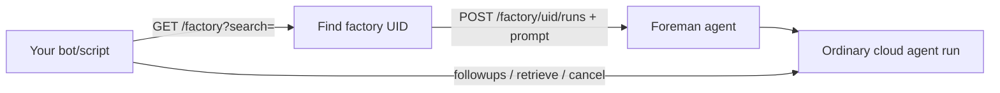

# Factory endpoints

> [[raw/docs/llms-docs-warp-dev/factories-factory-api|Raw]] · llms-txt

## Summary

The docs state that factory endpoints are part of the Warp Platform API and let your own code (a chat bot, script or service) find a factory and start work on it without learning the foreman agent's internals. [[raw/docs/llms-docs-warp-dev/factories-factory-api#Factory endpoints|cite]]

The page separates two API families. Factory endpoints cover discovery and dispatch. Agent and run endpoints cover everything after: follow-ups, status, cancellation, standalone cloud agents and orchestration. A dispatched factory run is "an ordinary cloud agent run", so it is managed through the same run endpoints as any other. [[raw/docs/llms-docs-warp-dev/factories-factory-api#Choosing an endpoint family|cite]]

It also positions the API against other intake paths: webhooks for tools like CI, Sentry or PagerDuty; Factory MCP for coding-agent sessions; integrations for chat platforms and issue trackers. [[raw/docs/llms-docs-warp-dev/factories-factory-api#Choosing how work reaches a factory|cite]]

## Key claims

- `GET /factory` lists accessible factories, with a case-insensitive `search` on name or alias; `GET /factory/{uid}` fetches one. [[raw/docs/llms-docs-warp-dev/factories-factory-api#Core endpoints|cite]]
- `POST /factory/{uid}/runs` dispatches to the factory's foreman; only `prompt` is required and the server resolves the foreman. [[raw/docs/llms-docs-warp-dev/factories-factory-api#Core endpoints|cite]]
- Optional fields: `title` (derived from the prompt if omitted), `ticket_ref` in `<source>:<id>` form (e.g. `linear:PAY-123`, `jira:PROJ-456`), and `ticket_url` to link the task record back. [[raw/docs/llms-docs-warp-dev/factories-factory-api#Dispatch a run to a factory|cite]]
- Follow-ups use `POST /agent/runs/{runId}/followups`; status uses `GET /agent/runs/{runId}`; cancel uses `POST /agent/runs/{runId}/cancel`. [[raw/docs/llms-docs-warp-dev/factories-factory-api#Choosing an endpoint family|cite]]
- Auth is a bearer API key; the Python `warp_platform_sdk` `WarpClient` exposes `factories.list`, `factories.get` and `factories.runs.create`, with automatic pagination. [[raw/docs/llms-docs-warp-dev/factories-factory-api#Discover a factory|cite]]

## Notable quotes

> "Discover factories and dispatch tasks by UID with factory endpoints, without learning the foreman agent's internals."
> — [[raw/docs/llms-docs-warp-dev/factories-factory-api#Factory endpoints|intro]]

## Connections

- **Entities**: [[wiki/entities/warp-factories]], [[wiki/entities/linear]], [[wiki/entities/jira]]
- **Concepts**: [[wiki/concepts/mcp]], [[wiki/concepts/webhook]]

> Synthesis: Vendor reference for the programmatic intake path of Warp Factories; it complements the run-management page (agent and run endpoints) and the webhook and MCP intake pages rather than adding a new idea.
