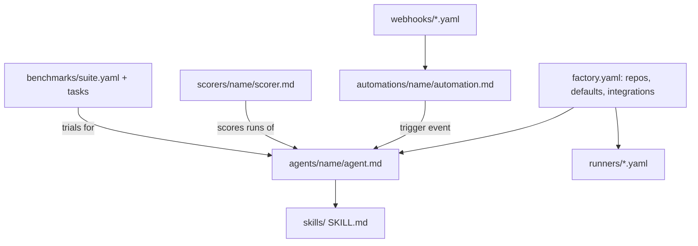

# Factory definition syntax

> [[raw/docs/llms-docs-warp-dev/factories-factory-as-code|Raw]] · llms-txt

## Summary

This is the reference page for the factory definition format. The docs state that a factory definition is a versioned tree of YAML and Markdown files rooted at `factory.yaml`, able to define agents, automations, runners, model routers, benchmarks, scorers, skills and webhooks. [[raw/docs/llms-docs-warp-dev/factories-factory-as-code#Factory definition syntax|cite]] Paths identify resources: `agents/reviewer/agent.md` is an agent named `reviewer`. Agents and automations are Markdown files whose frontmatter is configuration and whose body is the prompt. Runs, work items and metrics stay in the web app, outside the definition.

Hosting has two modes with the same file format. A Warp-managed factory is edited in the web app, and Warp validates, commits and applies it. On a paid plan the definition can live in the user's own GitHub repository, where merges to the production branch update the factory. [[raw/docs/llms-docs-warp-dev/factories-factory-as-code#Where the definition lives|cite]] Validation happens on save or in pull requests (`warp/factory-config` check), via a local Python script against Warp's validation service, via published JSON Schemas, or via a coding agent using Factory MCP. Warp applies a definition as one unit and keeps the last valid one on failure. [[raw/docs/llms-docs-warp-dev/factories-factory-as-code#Validate a definition|cite]]

The rest is field-level reference: `factory.yaml` defaults, agent roles, automation triggers per provider, runner compute shapes, router, benchmark, scorer and webhook files.

## Key claims

- Every factory has one foreman (`agentType: FOREMAN`), the entry point and default automation target; other roles are `TRIAGE`, `SPEC`, `IMPLEMENT`, `REVIEW`, `VERIFY` and `CUSTOM`. `spawnableBy` defaults to foreman-only. [[raw/docs/llms-docs-warp-dev/factories-factory-as-code#agentType|cite]]
- `agentDefaults` must set exactly one of `model` or `harness`. Harness `type` accepts `oz`, `claude`, `codex` or `claude-code`; third-party harnesses can authenticate via a managed secret or a self-hosted worker's environment. [[raw/docs/llms-docs-warp-dev/factories-factory-as-code#agentDefaults.harness|cite]]
- Automation triggers span GitHub, GitLab, Azure DevOps, Jira, Linear, Slack, Teams, cron schedules, custom webhooks and a factory-internal `work_item_stage_changed` event, with AND-combined filters. [[raw/docs/llms-docs-warp-dev/factories-factory-as-code#triggers|cite]]
- Credentials are not inlined: secrets are referenced by managed-secret name (`{{SECRET_NAME}}`), and `credentialStrategy` picks `EXECUTOR` or `CREATOR` identity. [[raw/docs/llms-docs-warp-dev/factories-factory-as-code#mcpServers|cite]]
- Scorers classify a sampled share of runs (`samplingRate` default 25) against a rubric with labels; with `selfImprovement: true`, failing scores can feed pull requests that propose definition changes. [[raw/docs/llms-docs-warp-dev/factories-factory-as-code#scorers/<name>/scorer.md|cite]]
- Benchmark suites run one agent across 1-6 configurations over tasks pinned to full commit SHAs, with `successCriteria` for a correctness scorer. [[raw/docs/llms-docs-warp-dev/factories-factory-as-code#benchmarks/<suite-slug>/suite.yaml|cite]]
- Runners define Linux, macOS or Windows sandboxes (Docker image for Linux, vCPU/memory shape, setup commands); `workerHost` routes runs to Warp-hosted or self-hosted compute. [[raw/docs/llms-docs-warp-dev/factories-factory-as-code#runners/<name>.yaml|cite]]

## Notable quotes

> "A factory definition is a versioned tree of YAML and Markdown files rooted at `factory.yaml`."
> — [[raw/docs/llms-docs-warp-dev/factories-factory-as-code#Factory definition syntax|Factory definition syntax]]

> "Warp applies the definition as one unit and keeps the last valid definition if validation fails."
> — [[raw/docs/llms-docs-warp-dev/factories-factory-as-code#Validate a definition|Validate a definition]]

## Connections

- **Entities**: [[wiki/entities/warp-factories]], [[wiki/entities/github]], [[wiki/entities/gitlab]], [[wiki/entities/azure-devops]], [[wiki/entities/jira]], [[wiki/entities/linear]], [[wiki/entities/slack]], [[wiki/entities/microsoft-teams]], [[wiki/entities/claude-code]], [[wiki/entities/codex]]
- **Concepts**: [[wiki/concepts/factory-as-code]], [[wiki/concepts/agent-skill]], [[wiki/concepts/mcp]], [[wiki/concepts/webhook]], [[wiki/concepts/agent-evals]], [[wiki/concepts/self-hosting]], [[wiki/concepts/secrets-management]], [[wiki/concepts/agent-runner]], [[wiki/concepts/agent-harness]]

> Synthesis: This is vendor reference material, not argument; it is the concrete schema behind the overview's claim that a factory is declarative, and shows the GitHub-merge-updates-factory loop and scorer-driven self-improvement as config-level features.
