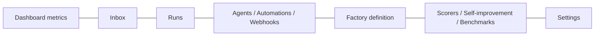

# Factory dashboard

> [[raw/docs/llms-docs-warp-dev/factories-factory-dashboard|Raw]] · llms-txt

## Summary

The docs state that the factory dashboard is the web app for operating a single factory: pick a factory in the Warp Factories web app, then track its work, inspect runs and pull requests, and manage agents, automations and settings. "Dashboard" (bold) is only one page inside it, the metrics landing page. [[raw/docs/llms-docs-warp-dev/factories-factory-dashboard#Getting oriented|cite]]

Runs, MCPs and apps, Secrets and Integrations are team-wide. Inbox is a single global page showing only items waiting on the viewer across all factories. Work is sent to a factory's foreman through New Chat. [[raw/docs/llms-docs-warp-dev/factories-factory-dashboard#Getting oriented|cite]]

Where the factory definition lives decides what is editable in the UI: Warp-managed, GitHub-managed (edit via PRs) or live-managed via API. The page is a tour of surfaces, not a how-to for any one.

## Key claims

- The docs define Autonomy as the share of merged PRs needing no human code push; opening the PR counts as a push, while comments, reviews and merge do not. [[raw/docs/llms-docs-warp-dev/factories-factory-dashboard#Read metrics on the Dashboard page|cite]]
- PR cycle time is the median from run kickoff through PR, first review and merge, with independent per-stage medians that do not sum to the headline. [[raw/docs/llms-docs-warp-dev/factories-factory-dashboard#Read metrics on the Dashboard page|cite]]
- Cost per PR is a median estimate, not an invoice; a run's cost includes child runs and splits evenly across the PRs it produces. [[raw/docs/llms-docs-warp-dev/factories-factory-dashboard#Read metrics on the Dashboard page|cite]]
- Inbox gathers questions, spec approvals and PR reviews awaiting a human; agent proposals to a Warp-managed definition surface as a spec review with Request changes or Approve & merge. [[raw/docs/llms-docs-warp-dev/factories-factory-dashboard#Edit definitions in the Factory definition tab|cite]]
- Automations trigger on a schedule (cron), a GitHub, Linear, Slack or Jira event, or a custom webhook; the Webhooks tab handles URLs, secret rotation and delivery log. For externally-managed definitions, Agents, Automations and Scorers are read-only. [[raw/docs/llms-docs-warp-dev/factories-factory-dashboard#Manage agents and automations|cite]]
- A run can be stopped, scored, or turned into a benchmark task; View session allows live follow-up while the sandbox is active. [[raw/docs/llms-docs-warp-dev/factories-factory-dashboard#Inspect runs|cite]]
- Settings cover identity and Foreman name, repositories, PR authorship (`credentialStrategy`), analysis model for Self-improvement, runners, integrations and deletion. [[raw/docs/llms-docs-warp-dev/factories-factory-dashboard#Change factory settings|cite]]

## Notable quotes

> "Anything managed in an external repository is read-only in Settings."
> — [[raw/docs/llms-docs-warp-dev/factories-factory-dashboard#Change factory settings|Change factory settings]]

## Connections

- **Entities**: [[wiki/entities/warp-factories]], [[wiki/entities/github]], [[wiki/entities/linear]], [[wiki/entities/slack]], [[wiki/entities/jira]]
- **Concepts**: [[wiki/concepts/factory-as-code]], [[wiki/concepts/agent-evals]], [[wiki/concepts/human-in-the-loop]], [[wiki/concepts/webhook]], [[wiki/concepts/agent-runner]], [[wiki/concepts/self-hosting]], [[wiki/concepts/secrets-management]]

> Synthesis: Vendor UI reference; its autonomy and cost-per-PR metrics and Inbox approvals are the concrete form of human-in-the-loop and eval ideas elsewhere in the wiki, but all claims are Warp's own.
