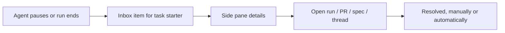

# Factory inbox

> [[raw/docs/llms-docs-warp-dev/factories-factory-inbox|Raw]] · llms-txt

## Summary

This short docs page describes **Inbox**, a sidebar view in Warp Factories that gathers everything factories need from one specific person, across every factory that person can access. The docs state it replaces checking each factory's Runs page for stalled or waiting work. [[raw/docs/llms-docs-warp-dev/factories-factory-inbox#Factory inbox|cite]]

It is the human-facing side of the factory's checkpoints: where an agent pauses for a decision, the item lands here. Being vendor documentation, everything below is the vendor's own account.

## Key claims

- The docs state each inbox item is one of six kinds: asked question, answered question (informational), spec review, PR review, blocked, failed. [[raw/docs/llms-docs-warp-dev/factories-factory-inbox#What appears in your inbox|cite]]
- Blocked and failed items appear only when nothing else on that task already needs the user's attention. [[raw/docs/llms-docs-warp-dev/factories-factory-inbox#What appears in your inbox|cite]]
- Inbox shows only work tied to tasks the user started. It is a personal queue, not a team feed: a teammate's blocked or failed task never appears. [[raw/docs/llms-docs-warp-dev/factories-factory-inbox#What appears in your inbox|cite]]
- Items clear on their own when no longer relevant (PR reviewed or merged, question answered), and the user can resolve any item manually, with Undo available. [[raw/docs/llms-docs-warp-dev/factories-factory-inbox#What appears in your inbox|cite]]
- Rows open a side pane with chips and a primary action such as View run, linking to the run, pull request, spec, or originating thread or ticket. Items can be marked read/unread, and filtered by factory, read state or kind, or searched. [[raw/docs/llms-docs-warp-dev/factories-factory-inbox#Reviewing your inbox|cite]]

## Notable quotes

> "Inbox only shows work tied to tasks *you* started. It's a personal queue, not a team-wide feed"
> — [[raw/docs/llms-docs-warp-dev/factories-factory-inbox#What appears in your inbox|location]]

## Connections

- **Entities**: [[wiki/entities/warp-factories]]
- **Concepts**: [[wiki/concepts/human-in-the-loop]]

> Synthesis: Concrete UI for the human-in-the-loop gates described on the Warp overview page; notable design choice is a per-person queue keyed to who started the task, so ownership of attention is explicit.
