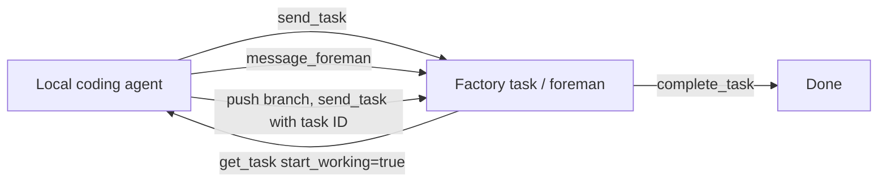

# Factory MCP for coding agents

> [[raw/docs/llms-docs-warp-dev/factories-factory-mcp|Raw]] · llms-txt

## Summary

The docs state that Factory MCP is a hosted Model Context Protocol server that connects coding agents to a team's factories. It is the bridge between a developer's local agent session and the cloud factory: an agent can send work in, pull a task down to continue locally, and return the result. [[raw/docs/llms-docs-warp-dev/factories-factory-mcp#Factory MCP for coding agents|cite]]

Beyond task handoff, the server covers onboarding (choose team, code host, repositories, agents, integrations, then create the factory) and definition editing (fetch JSON Schemas, validate definition files before a PR). In Warp it is preconfigured; elsewhere it is a streamable HTTP endpoint with browser sign-in, or an agent API key as bearer token for headless automation. [[raw/docs/llms-docs-warp-dev/factories-factory-mcp#Connect and authenticate|cite]]

The local-work loop is the core design: find task, pull context, coordinate with the task's foreman, push, hand back with `send_task`. Handing back does not complete the task; `complete_task` does. As vendor documentation, all of this is the vendor's own account.

## Key claims

- The docs state that the server is `https://app.warp.dev/api/v1/mcp/factory`, one connection reaches every factory the user can access, and Claude Code, Cursor and Codex are shown as example clients. [[raw/docs/llms-docs-warp-dev/factories-factory-mcp#In other MCP clients|cite]]
- The docs state there are no read-only or per-factory scopes: a connected client acts with the full permissions of its account or agent, and API keys belong in secret storage, never a repository. [[raw/docs/llms-docs-warp-dev/factories-factory-mcp#In other MCP clients|cite]]
- `get_task` with `start_working=true` returns status, run history and suggested Git commands for an isolated worktree; the docs state Factory MCP never modifies local files. [[raw/docs/llms-docs-warp-dev/factories-factory-mcp#Pick up a task and work on it locally|cite]]
- The docs state picking up a task does not claim, lock or pause it, so the user should check active runs and tell the foreman to avoid duplicate changes. Unpushed work is invisible to the factory. [[raw/docs/llms-docs-warp-dev/factories-factory-mcp#Pick up a task and work on it locally|cite]]
- Task references resolve from a task or run URL, GitHub PR, Slack permalink, Linear or Jira issue, or branch name. [[raw/docs/llms-docs-warp-dev/factories-factory-mcp#Pick up a task and work on it locally|cite]]
- Onboarding via MCP currently connects GitHub and GitLab only; Azure DevOps needs the web wizard. Notification delivery (for example Slack DM or Linear issue) is best-effort. [[raw/docs/llms-docs-warp-dev/factories-factory-mcp#Connect and authenticate|cite]]
- The tool reference lists 19 tools across factory listing, schema and validation, onboarding, and task operations. [[raw/docs/llms-docs-warp-dev/factories-factory-mcp#Tool reference|cite]]

## Notable quotes

> "Picking up a task doesn't claim, lock, or pause it, and the factory may keep running its own work on it in the meantime."
> — [[raw/docs/llms-docs-warp-dev/factories-factory-mcp#Pick up a task and work on it locally|location]]

## Connections

- **Entities**: [[wiki/entities/warp-factories]], [[wiki/entities/claude-code]], [[wiki/entities/codex]], [[wiki/entities/github]], [[wiki/entities/gitlab]], [[wiki/entities/azure-devops]], [[wiki/entities/slack]], [[wiki/entities/linear]], [[wiki/entities/jira]]
- **Concepts**: [[wiki/concepts/mcp]], [[wiki/concepts/factory-as-code]], [[wiki/concepts/git-worktree]], [[wiki/concepts/secrets-management]], [[wiki/concepts/software-factory]]

> Synthesis: Shows how a software factory exposes itself as an MCP server so local agents and cloud agents share one task, with the notable gap that access is all-or-nothing and tasks are not locked.
