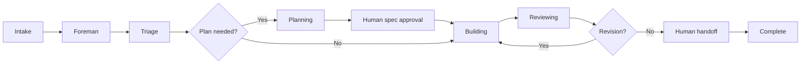

# How Warp Factories work

> [[raw/docs/llms-docs-warp-dev/factories-how-factories-work|Raw]] · llms-txt

## Summary

This is the conceptual overview page of Warp's Factories documentation. The docs state that a factory is a team of cloud agents connected to your repositories. A **foreman agent** coordinates the work and talks to people through the tool where the request started, such as Slack or Linear. It dispatches stage agents, and people make the key decisions. [[raw/docs/llms-docs-warp-dev/factories-how-factories-work#How Warp Factories work|cite]]

The unit of work is a **work item**: an issue, support request, pull request or Factory MCP task that keeps its identity from intake to handoff. The foreman picks the shortest path that still meets the quality policy, skipping or repeating stages as needed. [[raw/docs/llms-docs-warp-dev/factories-how-factories-work#How a work item moves through the factory|cite]]

The page closes with a self-improvement loop: scorers classify completed runs, and Self-improvement turns flagged failures into pull requests against application code or the factory's own definition. [[raw/docs/llms-docs-warp-dev/factories-how-factories-work#How the factory improves itself|cite]]

## Key claims

- The docs state the default stages are intake, triage (research and scoping), planning (spec agent), building (implement agent opens a PR with test and visual evidence), reviewing (review agent, verdict advisory) and human handoff. [[raw/docs/llms-docs-warp-dev/factories-how-factories-work#Stages|cite]]
- The docs state handoff alone does not complete a work item; by default the foreman completes it after a merge notification or confirmation the PR landed. [[raw/docs/llms-docs-warp-dev/factories-how-factories-work#Stages|cite]]
- Each agent run is a cloud agent run on Warp-hosted or managed self-hosted compute, using the agent's configured model and harness; runs are steered from a Runs page and input requests land in an inbox. [[raw/docs/llms-docs-warp-dev/factories-how-factories-work#Stages|cite]]
- By default a factory pauses in three places: spec approval, clarifying questions, and merging. The first two are workflow policy in the foreman's instructions; merging is enforced by repository branch protection and permissions. [[raw/docs/llms-docs-warp-dev/factories-how-factories-work#Where your team stays in charge|cite]]
- Agents, automations, runners, scorers, skills and webhooks are configured in definition files, managed by Warp or stored in a team-owned GitHub repository, where changes go through PR review and configuration checks. [[raw/docs/llms-docs-warp-dev/factories-how-factories-work#How the factory improves itself|cite]]
- The docs state every self-improvement proposal arrives as a pull request and "nothing is adopted on its own"; benchmarks compare configurations on the same tasks. [[raw/docs/llms-docs-warp-dev/factories-how-factories-work#How the factory improves itself|cite]]

## Notable quotes

> "A factory pauses when a person needs to decide."
> — [[raw/docs/llms-docs-warp-dev/factories-how-factories-work#Where your team stays in charge|Where your team stays in charge]]

> "Every proposal arrives as a pull request for your review; nothing is adopted on its own."
> — [[raw/docs/llms-docs-warp-dev/factories-how-factories-work#How the factory improves itself|How the factory improves itself]]

## Connections

- **Entities**: [[wiki/entities/warp-factories]], [[wiki/entities/slack]], [[wiki/entities/linear]], [[wiki/entities/github]]
- **Concepts**: [[wiki/concepts/agent-harness]], [[wiki/concepts/human-in-the-loop]], [[wiki/concepts/agent-evals]], [[wiki/concepts/factory-as-code]], [[wiki/concepts/self-hosting]], [[wiki/concepts/mcp]], [[wiki/concepts/agent-skill]], [[wiki/concepts/agent-runner]]

> Synthesis: Vendor description of a staged, human-gated agent pipeline with a score-and-propose self-improvement loop; it is the architectural spine that the sibling Warp Factories pages (agents, automations, dashboard, measure-and-improve) elaborate, so treat those as detail on this page, not independent evidence.
