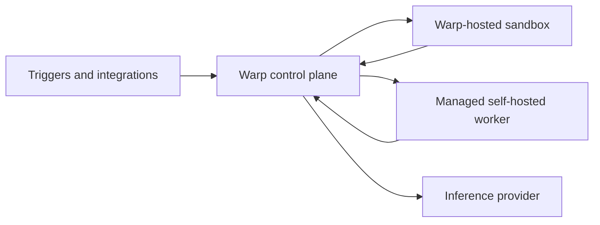

# About factory infrastructure and security

> [[raw/docs/llms-docs-warp-dev/factories-infrastructure-and-security|Raw]] · llms-txt

## Summary

The Warp docs state that Warp Factories separates execution, inference and credential boundaries. Teams choose where code runs, which provider serves inference, and which credentials each agent gets. Warp coordinates runs and stores transcripts and artifacts. [[raw/docs/llms-docs-warp-dev/factories-infrastructure-and-security#Control plane and execution plane|cite]]

The control plane (runs, identity/config, observability, integrations, storage, inference routing) is always Warp's. The execution plane is either a Warp-hosted sandbox or a managed self-hosted worker, backed by Docker (default), Kubernetes Jobs, or a Direct workspace. Self-hosting keeps checkouts, commands and sandbox files on the customer's machines, but prompts, results, transcripts and artifacts still flow through Warp and may contain code. [[raw/docs/llms-docs-warp-dev/factories-infrastructure-and-security#Choose an execution host|cite]]

Inference is chosen independently: Warp-managed, team-managed keys/endpoints, or AWS Bedrock BYOLLM. The page ends with a five-step deployment checklist and a factory role model (User, Editor, Admin).

## Key claims

- Managed self-hosting needs an Enterprise plan. The worker connects outbound to Warp, with no inbound firewall port. [[raw/docs/llms-docs-warp-dev/factories-infrastructure-and-security#Choose an execution host|cite]]
- The Warp Agent sends model requests through Warp. Claude Code and Codex call their providers directly from the execution environment. [[raw/docs/llms-docs-warp-dev/factories-infrastructure-and-security#Control plane and execution plane|cite]]
- Team-managed inference keys are encrypted by Warp and never enter the worker or run environment. Gemini Enterprise BYOLLM is not supported for factory runs. [[raw/docs/llms-docs-warp-dev/factories-infrastructure-and-security#Inference options for factory runs|cite]]
- Four credential kinds exist: inference, execution secrets (per-agent allowlist, none by default for non-user agents), harness auth, and repository identity (set by `credentialStrategy`). Redaction is a backstop, not a substitute for narrow permissions. [[raw/docs/llms-docs-warp-dev/factories-infrastructure-and-security#Credential boundaries|cite]]
- Factory roles: User views/runs and proposes changes; Editor edits the definition; Admin manages members and can force-merge blocked changes. Roles do not control spec or PR review, so definition files should be protected via repository settings. [[raw/docs/llms-docs-warp-dev/factories-infrastructure-and-security#Factory roles and permissions|cite]]
- Unmanaged self-hosted and other CLI agents cannot be the execution host but can exchange work through Factory MCP. [[raw/docs/llms-docs-warp-dev/factories-infrastructure-and-security#Choose an execution host|cite]]

## Notable quotes

> "Redaction is a backstop, not a substitute for narrow external permissions and rotation."
> — [[raw/docs/llms-docs-warp-dev/factories-infrastructure-and-security#Credential boundaries|Credential boundaries]]

## Connections

- **Entities**: [[wiki/entities/warp-factories]], [[wiki/entities/claude-code]], [[wiki/entities/codex]], [[wiki/entities/docker]], [[wiki/entities/kubernetes]]
- **Concepts**: [[wiki/concepts/control-plane]], [[wiki/concepts/self-hosting]], [[wiki/concepts/secrets-management]], [[wiki/concepts/agent-runner]], [[wiki/concepts/factory-as-code]], [[wiki/concepts/mcp]], [[wiki/concepts/human-in-the-loop]]

> Synthesis: Vendor documentation, so claims are the vendor's own; it is the clearest statement of Warp's control-plane/execution-plane split and the main security reference for the sibling self-hosting and secrets pages.
