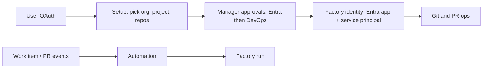

# Connecting Azure DevOps to your factory

> [[raw/docs/llms-docs-warp-dev/factories-integrations-azure-devops|Raw]] · llms-txt

## Summary

The docs state that a Warp factory can be connected to hosted Azure DevOps Services (`dev.azure.com`) so agents work in selected repositories, open pull requests, and start runs from work item and pull request events. Azure DevOps Server is not supported by the first-class integration; it goes through "other code forges". [[raw/docs/llms-docs-warp-dev/factories-integrations-azure-devops#Connecting Azure DevOps to your factory|cite]]

The access model uses three identities. The user's own OAuth connection only lists resources during setup and supplies the identity for creator-based runs. An "Azure DevOps Manager" creates and maintains factory identities in one Entra tenant and DevOps organization. Each factory then gets its own Entra application and service principal for Git and PR operations. [[raw/docs/llms-docs-warp-dev/factories-integrations-azure-devops#How identities and access work|cite]]

Setup needs two admin approvals in order: Entra (Global or Privileged Role Administrator) then Azure DevOps (Project Collection Administrator). Automations fire on listed events and filters, and can also be defined as code in the factory definition. [[raw/docs/llms-docs-warp-dev/factories-integrations-azure-devops#Connect Azure DevOps|cite]]

## Key claims

- The Manager has Basic access and Project Collection Administrators membership. The Entra approval is Graph `Application.ReadWrite.OwnedBy`, limited to apps the Manager owns. [[raw/docs/llms-docs-warp-dev/factories-integrations-azure-devops#Required administrator permissions|cite]]
- The Manager and every factory identity each use one Azure DevOps Basic seat, so licenses must be checked before adding factories. [[raw/docs/llms-docs-warp-dev/factories-integrations-azure-devops#Required administrator permissions|cite]]
- Warp does not retain the administrator's sign-in; tenant approval can be reused for another organization in the same tenant, but each organization needs its own DevOps approval. [[raw/docs/llms-docs-warp-dev/factories-integrations-azure-devops#Required administrator permissions|cite]]
- Before starting a run, Warp checks the automation creator's Azure DevOps OAuth connection; each creator must keep it active with required scopes. New factories get a default automation for PR mentions, work item mentions and work item assignments. [[raw/docs/llms-docs-warp-dev/factories-integrations-azure-devops#Configure Azure DevOps automations|cite]]
- Supported events: work item created/assigned/labeled/mentioned, and PR created/merged/closed/updated/commented/mentioned. `push` is accepted in definition files only, not the editor. `source_repos` matches the PR source branch's repository. [[raw/docs/llms-docs-warp-dev/factories-integrations-azure-devops#Supported events and filters|cite]]
- Known quirk: the factory identity may be missing from comment @-autocomplete until assigned to a work item once; plain-text names do not trigger automations. [[raw/docs/llms-docs-warp-dev/factories-integrations-azure-devops#Factory identity doesn’t appear in comment mention autocomplete|cite]]

## Notable quotes

> "The first-class integration supports hosted Azure DevOps Services at `dev.azure.com`. It doesn’t support Azure DevOps Server."
> — [[raw/docs/llms-docs-warp-dev/factories-integrations-azure-devops#Connecting Azure DevOps to your factory|intro]]

## Connections

- **Entities**: [[wiki/entities/warp-factories]], [[wiki/entities/azure-devops]]
- **Concepts**: [[wiki/concepts/factory-as-code]], [[wiki/concepts/webhook]]

> Synthesis: Vendor integration doc; shows the dedicated-identity-per-factory pattern (separate service principal, seat cost) rather than reusing a user token, a security trade-off worth comparing with the other forge pages.
