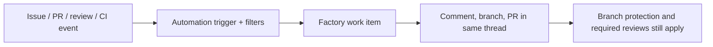

# Connect GitHub to your factory

> [[raw/docs/llms-docs-warp-dev/factories-integrations-github|Raw]] · llms-txt

## Summary

This is the setup and reference page for the GitHub work source of Warp Factories. The docs state that one Warp GitHub App installation serves both the platform integration and factories, and that once repositories are selected in the setup wizard, repository activity starts factory work. The factory replies in the originating thread. [[raw/docs/llms-docs-warp-dev/factories-integrations-github#Connect GitHub to a factory|cite]]

Routing is label-driven. New factories get default automations for mentions and assignments, issue and pull request labeled, review submitted, and pull request closed or merged. The `factory:<alias>` label (alias = the dashboard's "Foreman name") plus an **@warp** mention routes work to a specific factory. Custom automations add GitHub triggers narrowed by filters such as branches, paths, labels, authors, workflows and conclusions. [[raw/docs/llms-docs-warp-dev/factories-integrations-github#Mention the factory|cite]]

The page also covers permissions, a `warp/factory-config` check for factory definitions managed as code, and troubleshooting. Being vendor documentation, all of this is the vendor's own account.

## Key claims

- The docs state supported triggers cover issues, pull requests (including merge-queue add/remove), reviews, push, and completed check suites or workflow runs. [[raw/docs/llms-docs-warp-dev/factories-integrations-github#Supported triggers|cite]]
- The docs state GitHub triggers skip bot events by default (`skip_bots` defaults to `all`); `self` admits third-party bots but not Warp-owned ones, and admitting Warp-owned bots can cause feedback loops. [[raw/docs/llms-docs-warp-dev/factories-integrations-github#Events from bots don't start work|cite]]
- The docs state branches and pull requests the factory creates follow normal repository rules: branch protection, required reviews and merge requirements all still apply. [[raw/docs/llms-docs-warp-dev/factories-integrations-github#How the factory responds on GitHub|cite]]
- The docs state runs authenticate with the GitHub App installation; its repositories and permissions control access, while automation filters only control when work starts. [[raw/docs/llms-docs-warp-dev/factories-integrations-github#Permissions|cite]]
- For definitions as code, a **warp/factory-config** check validates the head commit and dry-runs the change, catching a missing secret, runner, MCP server or model; it can be required in branch protection. [[raw/docs/llms-docs-warp-dev/factories-integrations-github#Factory-definition pull request checks|cite]]
- A failed-CI example automation (`workflow_run_completed`, branch `main`, conclusion `failure`) tells the agent to open a fix PR if the cause is small, else an issue. [[raw/docs/llms-docs-warp-dev/factories-integrations-github#Add a custom automation|cite]]

## Notable quotes

> "Only new content counts as a mention. Edits and mentions inside code blocks are ignored."
> — [[raw/docs/llms-docs-warp-dev/factories-integrations-github#Mention the factory|location]]

## Connections

- **Entities**: [[wiki/entities/warp-factories]], [[wiki/entities/github]]
- **Concepts**: [[wiki/concepts/factory-as-code]], [[wiki/concepts/webhook]], [[wiki/concepts/human-in-the-loop]]

> Synthesis: Concrete GitHub adapter detail for the Warp Factories hub page; shows the human gate living in ordinary GitHub branch protection rather than in factory-specific approval.
