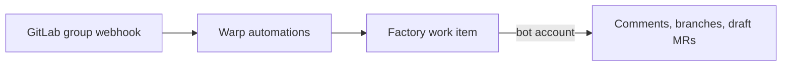

# Connect GitLab to your factory

> [[raw/docs/llms-docs-warp-dev/factories-integrations-gitlab|Raw]] · llms-txt

## Summary

The docs describe how a Warp factory attaches to GitLab. One top-level GitLab group links one-to-one to a Warp workspace. Warp does not use a marketplace app. It creates service accounts in the group: one manager account per workspace, and one bot account per factory. A group webhook delivers merge request and comment events to Warp, and matching automations turn them into factory work. [[raw/docs/llms-docs-warp-dev/factories-integrations-gitlab#Service accounts and access|cite]]

Two triggers exist: merge request events and bot mentions. The factory answers as its bot. It replies in thread, pushes `factory/<slug>` branches, opens draft merge requests, labels what it touches, and posts review feedback as a summary note plus inline discussions. The docs state it never merges or approves; those decisions stay with the team. [[raw/docs/llms-docs-warp-dev/factories-integrations-gitlab#How the factory responds on GitLab|cite]]

The access model is bot-centric. Runs use short-lived tokens scoped to the bot's Developer role on the selected projects, not the triggering person's rights. Automation filters decide when work starts, not what a running agent can reach. [[raw/docs/llms-docs-warp-dev/factories-integrations-gitlab#Permissions|cite]]

## Key claims

- The docs state prerequisites: GitLab.com (self-managed needs another code-forge setup), group Owner access, and a Premium or Ultimate plan for service accounts and group webhooks. [[raw/docs/llms-docs-warp-dev/factories-integrations-gitlab#Prerequisites|cite]]
- The manager account holds Owner on the group, and its provisioning token is valid for one year. Each factory bot is named from the factory alias plus a `-warp-` suffix and unique ID. [[raw/docs/llms-docs-warp-dev/factories-integrations-gitlab#Service accounts and access|cite]]
- A default editable automation, **gitlab-bot-mentions**, fires when the bot is mentioned. Merge request triggers fire on opened, updated, closed, reopened, merged or approved, and filter by project, action and base branch. [[raw/docs/llms-docs-warp-dev/factories-integrations-gitlab#Supported triggers|cite]]
- Mentions count only in new comments. Edits and activity from Warp's own service accounts never trigger work, so factories cannot re-trigger themselves or each other. [[raw/docs/llms-docs-warp-dev/factories-integrations-gitlab#Mention the factory|cite]]
- Anyone who can create matching activity can start work. The commenter need not be a Warp team member. [[raw/docs/llms-docs-warp-dev/factories-integrations-gitlab#Permissions|cite]]
- Triggers can be declared in an automation file (`provider: gitlab`, `event: merge_request`). GitLab is not yet supported as a definition-hosting repository, so definitions must live in a Warp-managed or GitHub-hosted repo. [[raw/docs/llms-docs-warp-dev/factories-integrations-gitlab#Definitions as code|cite]]
- Without group webhooks, factory credentials work but GitLab cannot trigger runs. [[raw/docs/llms-docs-warp-dev/factories-integrations-gitlab#Service accounts and access|cite]]

## Notable quotes

> "The factory never merges or approves a merge request; those decisions stay with your team."
> — [[raw/docs/llms-docs-warp-dev/factories-integrations-gitlab#How the factory responds on GitLab|location]]

## Connections

- **Entities**: [[wiki/entities/warp-factories]], [[wiki/entities/gitlab]], [[wiki/entities/github]]
- **Concepts**: [[wiki/concepts/webhook]], [[wiki/concepts/factory-as-code]], [[wiki/concepts/human-in-the-loop]]

> Synthesis: Vendor documentation, not independent evidence; it shows Warp's GitLab path is a bot-identity-per-factory design that keeps merge and approval human, and that GitLab lags GitHub (no definition hosting).
