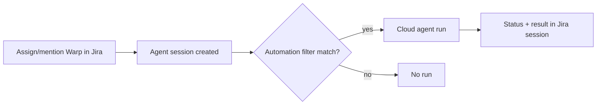

# Connect Jira to your factory

> [[raw/docs/llms-docs-warp-dev/factories-integrations-jira|Raw]] · llms-txt

## Summary

The docs state that a Jira Cloud site (not Server or Data Center) can be connected to a Warp factory so teams start work from Jira. When someone assigns or mentions **Warp** on a work item, Jira opens an agent session, a factory automation routes it to the chosen agent, and the same session shows progress and the final result. [[raw/docs/llms-docs-warp-dev/factories-integrations-jira#Connect Jira to your factory|cite]]

Setup has two levels. A Jira site admin installs the Warp app and connects the site to the workspace (once, shared by all factories). Each factory then opts in separately under Settings > Integrations, selecting projects, and gets an automation with a **Jira > Agent session created** trigger. [[raw/docs/llms-docs-warp-dev/factories-integrations-jira#Connect Jira and add an automation|cite]] The same automation can be declared as code: `integrations: [{type: jira}]` in `factory.yaml` plus an `automations/<name>/automation.md` file with `provider: jira`, `event: agent_session_created` and a filter. [[raw/docs/llms-docs-warp-dev/factories-integrations-jira#Configure the automation as code|cite]]

## Key claims

- Only one event exists, `agent_session_created`; filters are `project_keys` and `keywords` (case-insensitive). A session must match every set field; any value within a field matches. [[raw/docs/llms-docs-warp-dev/factories-integrations-jira#Filter which sessions start runs|cite]]
- Jira events are offered to every automation in the workspace, so another team's broader filter can start its own run on the same work item; filters do not control access. [[raw/docs/llms-docs-warp-dev/factories-integrations-jira#Filter which sessions start runs|cite]]
- The agent starts with the assignment text and work item; with Jira declared as an integration it can read details, comments and workflow transitions. Replies in the same session continue the same run. [[raw/docs/llms-docs-warp-dev/factories-integrations-jira#What happens during a run|cite]]
- The agent does not comment on the work item unless asked; when asked it can update fields, comment, transition status, change labels or reassign, bounded by Jira permissions. [[raw/docs/llms-docs-warp-dev/factories-integrations-jira#What happens during a run|cite]]
- A connected Jira user becomes the run's creator, but the run executes as the automation's agent. Jira access gives no repository access; that comes from the factory. [[raw/docs/llms-docs-warp-dev/factories-integrations-jira#Permissions|cite]]
- Built-in Jira tools read Jira as the run creator. For runs with no human creator (scheduled, service account, API key), the docs say to add the Atlassian MCP server as a managed MCP install. [[raw/docs/llms-docs-warp-dev/factories-integrations-jira#Permissions|cite]]
- Non-admins can send an approval link to a site admin; it expires after seven days. [[raw/docs/llms-docs-warp-dev/factories-integrations-jira#Connect Jira and add an automation|cite]]

## Notable quotes

> "Jira access doesn't include code access"
> — [[raw/docs/llms-docs-warp-dev/factories-integrations-jira#Permissions|Permissions]]

## Connections

- **Entities**: [[wiki/entities/warp-factories]], [[wiki/entities/jira]]
- **Concepts**: [[wiki/concepts/factory-as-code]], [[wiki/concepts/mcp]]

> Synthesis: Vendor how-to for one trigger source (Jira) in Warp Factories; the automation-as-code and shared-event-visibility caveats mirror what sibling integration pages (Linear, Slack) likely repeat, so count them as one pattern.
