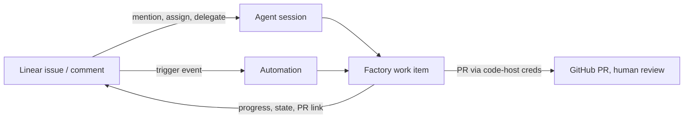

# Connect Linear to your factory

> [[raw/docs/llms-docs-warp-dev/factories-integrations-linear|Raw]] · llms-txt

## Summary

The docs state that connecting Linear lets a team send issues to a Warp factory without leaving Linear: assign an issue to the factory or tag it in a comment, and the factory picks it up with the issue's full context, then keeps the issue updated as work moves through its stages. When the factory needs an answer, the user replies in Linear or opens the live run to steer the agent. [[raw/docs/llms-docs-warp-dev/factories-integrations-linear#Connect Linear to your factory|cite]]

Setup is two steps, at factory creation or later in Settings: authorize Warp via Linear OAuth (once per workspace), and pick which Linear teams trigger the factory. Warp then adds a default automation routing new agent sessions from those teams to the factory. Issue and comment activity starts nothing until triggers are added. [[raw/docs/llms-docs-warp-dev/factories-integrations-linear#Connect Linear|cite]]

Two entry paths exist: explicit agent sessions (mention, assign or delegate the Warp app) and automation triggers on issue and comment events. Each event type determines what context the agent receives and what is sent back. [[raw/docs/llms-docs-warp-dev/factories-integrations-linear#Supported events and outputs|cite]]

## Key claims

- Agent sessions start when someone mentions, assigns or delegates the Warp app; the default automation routes sessions from selected teams. Replies in a session continue that run. Narrowing by creator or keyword means editing the `agent_session_created` trigger in definition files, not the automation editor. [[raw/docs/llms-docs-warp-dev/factories-integrations-linear#Route agent sessions|cite]]
- Automation triggers cover five events: Issue created, labeled, state changed, assigned, and Comment created. All filter on teams and labels; More filters adds project, workflow state, assignee, mentioned user, and a specific issue for comments. [[raw/docs/llms-docs-warp-dev/factories-integrations-linear#Configure Linear triggers|cite]]
- Once an issue is linked to a work item, later matching events continue the same work item rather than creating a new one. [[raw/docs/llms-docs-warp-dev/factories-integrations-linear#Follow-up events on the same issue|cite]]
- One comment can match both an agent-session route and a Comment created trigger, starting two runs; the docs advise scoping automations so one path owns each request kind. [[raw/docs/llms-docs-warp-dev/factories-integrations-linear#Follow-up events on the same issue|cite]]
- The factory posts plans, actions and results, attaches GitHub PRs, updates workflow state or delegate, and acknowledges comments. Its own Linear activity never triggers automations, preventing loops. [[raw/docs/llms-docs-warp-dev/factories-integrations-linear#What the factory can do in Linear|cite]]
- Only agent sessions require a Warp account linked to the Linear user; unlinked issue and comment events still run but requester may not be recorded. Linear auth grants no repo access: PRs use the factory's code-host credentials. [[raw/docs/llms-docs-warp-dev/factories-integrations-linear#What the factory can do in Linear|cite]]

## Notable quotes

> "the pull request still waits for a person to review and merge."
> — [[raw/docs/llms-docs-warp-dev/factories-integrations-linear#What the factory can do in Linear|What the factory can do in Linear]]

> "Its own Linear activity never triggers automations, so a factory can't set itself off in a loop."
> — [[raw/docs/llms-docs-warp-dev/factories-integrations-linear#What the factory can do in Linear|What the factory can do in Linear]]

## Connections

- **Entities**: [[wiki/entities/warp-factories]], [[wiki/entities/linear]], [[wiki/entities/github]]
- **Concepts**: [[wiki/concepts/factory-as-code]], [[wiki/concepts/human-in-the-loop]]

> Synthesis: Vendor doc for one issue-tracker adapter; the notable design points are loop-proofing, double-trigger overlap risk, and the human merge gate, likely mirrored by sibling Jira/GitHub integration pages.
