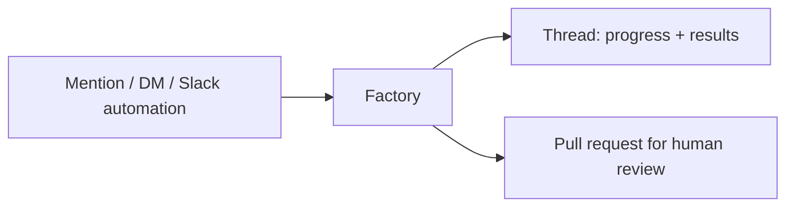

# Connect Slack to your factory

> [[raw/docs/llms-docs-warp-dev/factories-integrations-slack|Raw]] · llms-txt

## Summary

The docs state that each factory appears in Slack as its own app, with the factory's name and avatar. A channel can host several factories. Mentioning the app or DMing it starts work with the conversation as context. Progress and results come back in the same thread. [[raw/docs/llms-docs-warp-dev/factories-integrations-slack#Connect Slack to your factory|cite]]

Install happens from factory creation or Settings. An administrator may need to approve it, and the app must be invited to each channel (private channels always). A 👀 reaction confirms pickup. [[raw/docs/llms-docs-warp-dev/factories-integrations-slack#Connect the factory|cite]]

Beyond mentions, a Slack trigger on a factory automation starts work with no mention. Warp also gives agents built-in Slack tools (read channels and threads, reply, post top-level messages) during any factory run, so no separate Slack MCP server is needed. [[raw/docs/llms-docs-warp-dev/factories-integrations-slack#Use integration-provided tools|cite]]

## Key claims

- Slack automation triggers: app mentioned, DM received (`message_dm`), message posted in channel, reaction added, member joined channel. Each has its own filters (conversations, authors, keywords, emoji, reactors). [[raw/docs/llms-docs-warp-dev/factories-integrations-slack#Configure factory automations for Slack|cite]]
- One Slack message can match several automations. An app-mention trigger plus a channel-message trigger in the same channel yields two runs. [[raw/docs/llms-docs-warp-dev/factories-integrations-slack#Configure factory automations for Slack|cite]]
- Linear and Jira tools are also auto-provided to agents. The docs call these Warp-managed and separate from user-configured MCP servers. [[raw/docs/llms-docs-warp-dev/factories-integrations-slack#Use integration-provided tools|cite]]
- Example automations: a `:ticket:` reaction files a GitHub issue. A cron `0 2 * * *` automation for agent `foreman` posts a nightly digest to an explicit Slack channel ID. [[raw/docs/llms-docs-warp-dev/factories-integrations-slack#Post a scheduled factory digest to Slack|cite]]
- A thread reply continues work only if the thread already has a work item. The app's Home tab groups work items by stage: Triage, Planning, Building, Reviewing, Complete, Cancelled. [[raw/docs/llms-docs-warp-dev/factories-integrations-slack#Follow work and review outputs|cite]]
- Starting work by mention or DM requires a Slack account linked to an active member of the factory's Warp team. Automation-started work runs as the chosen factory agent, not the triggerer. [[raw/docs/llms-docs-warp-dev/factories-integrations-slack#Who can start work|cite]]
- Work from Slack still ends at a pull request for a person to review. [[raw/docs/llms-docs-warp-dev/factories-integrations-slack#Follow work and review outputs|cite]]

## Notable quotes

> "A single Slack message can match more than one automation."
> — [[raw/docs/llms-docs-warp-dev/factories-integrations-slack#Configure factory automations for Slack|location]]

> "You don't need to install a separate Slack MCP server to post factory output to Slack."
> — [[raw/docs/llms-docs-warp-dev/factories-integrations-slack#Use integration-provided tools|location]]

## Connections

- **Entities**: [[wiki/entities/warp-factories]], [[wiki/entities/slack]], [[wiki/entities/github]], [[wiki/entities/linear]], [[wiki/entities/jira]]
- **Concepts**: [[wiki/concepts/factory-as-code]], [[wiki/concepts/foreman-agent]], [[wiki/concepts/mcp]], [[wiki/concepts/human-in-the-loop]]

> Synthesis: Vendor integration doc: Slack as intake and status surface for a factory, with identity mapping and a PR review gate as the human control points; GitHub, Linear and Jira appear only as adjacent integrations.
