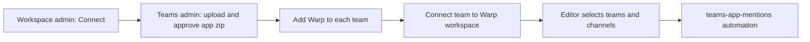

# Connect Microsoft Teams to your factory

> [[raw/docs/llms-docs-warp-dev/factories-integrations-teams|Raw]] · llms-txt

## Summary

This Warp Factories docs page is a setup and reference guide for the Microsoft Teams intake path. The docs state that mentioning @Warp in a standard or shared channel starts a factory work item, and replies post in the same thread. [[raw/docs/llms-docs-warp-dev/factories-integrations-teams#Set up Microsoft Teams|cite]]

Setup is split across three roles: a Warp workspace admin, a Teams admin or team owner (who uploads and approves the app package), and a factory editor (who selects teams and channels). Setup can be delegated through an approval link. After setup, Warp seeds a `teams-app-mentions` automation, which the user edits to choose what triggers work. [[raw/docs/llms-docs-warp-dev/factories-integrations-teams#Who completes each part|cite]]

The page also covers shared-channel rules, the Teams tools given to agents, a code-based config example, troubleshooting, disconnecting, and privacy.

## Key claims

- Only standard and shared channels work. Private channels and direct messages are not supported. [[raw/docs/llms-docs-warp-dev/factories-integrations-teams#Who completes each part|cite]]
- Triggers are `app_mention` (default) and `message_posted`. If both target one channel, a single mention can start two runs. [[raw/docs/llms-docs-warp-dev/factories-integrations-teams#Choose what starts work|cite]]
- Shared channels: the app must be installed in the owning team. Only users in that Microsoft 365 org with a linked, active Warp member account can act, and root messages must mention @Warp. An agent run can read only its originating thread. [[raw/docs/llms-docs-warp-dev/factories-integrations-teams#Use shared channels|cite]]
- Agents get Warp-managed Teams tools: read the thread, reply, post a top-level message, resolve a member. They cannot list channels, send DMs, react, or upload files, and are separate from configured MCP servers. [[raw/docs/llms-docs-warp-dev/factories-integrations-teams#What agents can do in Teams|cite]]
- As code, the integration is `type: microsoft-teams` in `factory.yaml` (with `autoRespondToThreadReplies`), plus an `automations/teams-app-mentions/automation.md` file with `agent: foreman`, Graph `team_ids` and `19:…@thread.tacv2` `channel_ids`. [[raw/docs/llms-docs-warp-dev/factories-integrations-teams#Configure Microsoft Teams as code|cite]]
- Users must link a Microsoft account to a Warp account; `sign out` unlinks it from every factory in that Microsoft org. [[raw/docs/llms-docs-warp-dev/factories-integrations-teams#Start and continue work|cite]]

## Notable quotes

> "Private channels and direct messages are not supported."
> — [[raw/docs/llms-docs-warp-dev/factories-integrations-teams#Who completes each part|Who completes each part]]

## Connections

- **Entities**: [[wiki/entities/warp-factories]], [[wiki/entities/microsoft-teams]], [[wiki/entities/slack]]
- **Concepts**: [[wiki/concepts/factory-as-code]], [[wiki/concepts/foreman-agent]], [[wiki/concepts/mcp]]

> Synthesis: Vendor docs for one chat intake path, the Teams counterpart to Slack; it shows how a factory routes chat events to a foreman agent through automations, but claims here are the vendor's own.
