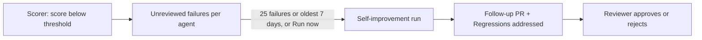

# Configuring and reviewing Self-improvement

> [[raw/docs/llms-docs-warp-dev/factories-measure-and-improve-self-improvement|Raw]] · llms-txt

## Summary

This Warp Factories docs page describes a feedback loop. The user enables **Self-improvement** per Scorer. A failure is a score below that Scorer's pass threshold. The docs state that a scheduled check groups unreviewed failures per agent and starts a follow-up run that proposes a fix. [[raw/docs/llms-docs-warp-dev/factories-measure-and-improve-self-improvement#Configuring and reviewing Self-improvement|cite]]

The fix is a pull request, not an automatic change. The docs state that a run can change application code, and can also improve the factory itself. When the factory is managed as definitions as code, its prompts, skills and configuration are version-controlled files, so the run can open a PR against the factory definition. "Nothing is adopted without your review." [[raw/docs/llms-docs-warp-dev/factories-measure-and-improve-self-improvement#Configuring and reviewing Self-improvement|cite]]

## Key claims

- The docs state the scheduled check starts a run once an agent has 25 distinct unreviewed failures, or when its oldest unreviewed failure is seven days old. [[raw/docs/llms-docs-warp-dev/factories-measure-and-improve-self-improvement#Configuring and reviewing Self-improvement|cite]]
- For a GitHub-backed factory, `selfImprovement.failedRunThreshold` in `factory.yaml` changes the threshold to any value from 1 through 50. [[raw/docs/llms-docs-warp-dev/factories-measure-and-improve-self-improvement#Configuring and reviewing Self-improvement|cite]]
- `reviewerType` accepts `admins` (default: team admins and owners), `team` (any member), `none`, and `custom` (members in `reviewerEmails`). Warp randomly requests one eligible reviewer unless `none` is set. [[raw/docs/llms-docs-warp-dev/factories-measure-and-improve-self-improvement#Configuring and reviewing Self-improvement|cite]]
- **Run now** on the dashboard's Self-improvement page skips the threshold. An ad hoc run can include an agent with one unreviewed failure. The user cannot choose which agents or failures it processes. [[raw/docs/llms-docs-warp-dev/factories-measure-and-improve-self-improvement#Configuring and reviewing Self-improvement|cite]]
- Each PR has a **Regressions addressed** section linking the failing runs and Scorer results behind it, so the change traces back to evidence. [[raw/docs/llms-docs-warp-dev/factories-measure-and-improve-self-improvement#Configuring and reviewing Self-improvement|cite]]

## Notable quotes

> "Nothing is adopted without your review."
> — [[raw/docs/llms-docs-warp-dev/factories-measure-and-improve-self-improvement#Configuring and reviewing Self-improvement|Configuring and reviewing Self-improvement]]

## Connections

- **Entities**: [[wiki/entities/warp-factories]], [[wiki/entities/github]]
- **Concepts**: [[wiki/concepts/agent-evals]], [[wiki/concepts/factory-as-code]], [[wiki/concepts/human-in-the-loop]], [[wiki/concepts/agent-skill]]

> Synthesis: Vendor docs for a closed loop in which eval failures (Scorers) feed PRs that can rewrite the factory's own prompts and skills, gated by a human reviewer; it pairs with the Scorers and benchmarks pages rather than standing alone.
