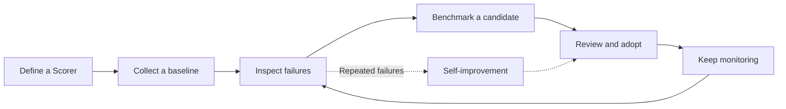

# Measure and improve a factory

> [[raw/docs/llms-docs-warp-dev/factories-measure-and-improve|Raw]] · llms-txt

## Summary

The docs state that Warp Factories tracks what a factory produces and how well it performs, through four features: Dashboard metrics (output and cost), Scorers (do completed runs meet criteria you define), Benchmarks (how configurations compare on the same tasks) and Self-improvement (repeated failures investigated and turned into follow-up work). [[raw/docs/llms-docs-warp-dev/factories-measure-and-improve#Measure and improve a factory|cite]]

The page is an index and method guide. It defines each Dashboard metric, warns about how to read them, and sketches a six-step improvement loop. Detail for Scorers, Self-improvement and Benchmarks lives on separate pages.

## Key claims

- The Dashboard reports total runs, PRs opened, PRs merged, autonomy, PR cycle time, cost per PR, most expensive PRs, Scorer cards and the three newest Self-improvement PRs. [[raw/docs/llms-docs-warp-dev/factories-measure-and-improve#Read metrics on the Dashboard page|cite]]
- Autonomy is the share of merged factory PRs needing no human code push before merge; opening the PR counts as a push, so a human-authored PR later revised by a run is not autonomous. [[raw/docs/llms-docs-warp-dev/factories-measure-and-improve#Read metrics on the Dashboard page|cite]]
- Cost per PR is the median cost of PRs opened in range, including child runs, split evenly across a run's PRs, viewable by cost component or PR size (S/M/L/XL, split at 100/500/1,000 changed lines). It is a comparison metric, not a billing figure. [[raw/docs/llms-docs-warp-dev/factories-measure-and-improve#Read metrics on the Dashboard page|cite]]
- PRs merged, Autonomy, PR cycle time and Most expensive PR detail need a connected code host (GitHub App, or the GitLab webhook Warp installs) and only cover activity after connection. [[raw/docs/llms-docs-warp-dev/factories-measure-and-improve#Read metrics on the Dashboard page|cite]]
- A Scorer is an LLM judge that classifies completed runs against criteria you write. A benchmark compares model and runner configurations for a single agent on fixed tasks. Self-improvement turns a Scorer's repeated failures into follow-up PRs against application code or the factory's own definition. [[raw/docs/llms-docs-warp-dev/factories-measure-and-improve#Configure Scorers|cite]] [[raw/docs/llms-docs-warp-dev/factories-measure-and-improve#Configure and review Self-improvement|cite]]
- Self-improvement PRs should be reviewed to the same standard as human-authored ones; a Scorer can be retired by setting its sample rate to 0. [[raw/docs/llms-docs-warp-dev/factories-measure-and-improve#Run a practical improvement loop|cite]]

## Notable quotes

> "Use the **Dashboard** page to pick which runs to investigate, not to conclude what caused a change."
> — [[raw/docs/llms-docs-warp-dev/factories-measure-and-improve#Read metrics on the Dashboard page|Read metrics on the Dashboard page]]

> "Change one measurable thing at a time"
> — [[raw/docs/llms-docs-warp-dev/factories-measure-and-improve#Run a practical improvement loop|Run a practical improvement loop]]

## Connections

- **Entities**: [[wiki/entities/warp-factories]], [[wiki/entities/github]], [[wiki/entities/gitlab]]
- **Concepts**: [[wiki/concepts/agent-evals]], [[wiki/concepts/factory-as-code]], [[wiki/concepts/webhook]]

> Synthesis: Vendor docs describing Warp's built-in eval loop (LLM-judge Scorers, benchmarks, self-improving PRs); the caveat that Total runs includes eval and benchmark runs shows measurement itself inflates the headline metrics.
