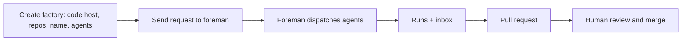

# Warp Factories quickstart

> [[raw/docs/llms-docs-warp-dev/factories-quickstart|Raw]] · llms-txt

## Summary

This is a vendor quickstart. The docs state the goal is to create a first factory and take one small work item from prompt to pull request. [[raw/docs/llms-docs-warp-dev/factories-quickstart#Warp Factories quickstart|cite]] Prerequisites are a Warp account in a Warp team, admin access or the Warp Factories Editor role, usage balance for runs, and access to the target repositories. [[raw/docs/llms-docs-warp-dev/factories-quickstart#Prerequisites|cite]]

Setup is a web-app wizard: pick a code host (GitHub, GitLab or Azure DevOps) and organization, select repositories, name the factory, choose which agents the foreman may dispatch (Triage, Spec, Code, Review shown enabled by default), and optionally connect Slack and an issue tracker. [[raw/docs/llms-docs-warp-dev/factories-quickstart#Set up your factory|cite]] The docs state a coding agent connected to Factory MCP can run this setup for GitHub and GitLab, but Azure DevOps needs the web app and a one-time administrator approval.

The first request goes to the foreman, the factory's coordinator, as a chat in the web app (or from Slack or an issue tracker). The foreman dispatches the agents it needs, progress shows under Runs as foreman and child runs, and input requests land in an inbox. The human reviews the returned pull request and merges by their normal process. [[raw/docs/llms-docs-warp-dev/factories-quickstart#Send your first work item|cite]]

## Key claims

- The factory name also sets the default foreman name, the handle the team @-mentions in Slack and Linear. [[raw/docs/llms-docs-warp-dev/factories-quickstart#Set up your factory|cite]]
- Leaving the Code agent enabled is what makes the quickstart end in a pull request. [[raw/docs/llms-docs-warp-dev/factories-quickstart#Set up your factory|cite]]
- Azure DevOps requires one-time administrator approval, and the approval link can be sent during setup. Other code forges have a separate page. [[raw/docs/llms-docs-warp-dev/factories-quickstart#Set up your factory|cite]]
- Slack and an issue tracker are optional at setup and can be added later. [[raw/docs/llms-docs-warp-dev/factories-quickstart#Set up your factory|cite]]
- The recommended first request is one small, verifiable change, limited to one file, with a lint check and a pull request. [[raw/docs/llms-docs-warp-dev/factories-quickstart#Send your first work item|cite]]
- Work started in Slack shows live progress in its thread. [[raw/docs/llms-docs-warp-dev/factories-quickstart#Send your first work item|cite]]

## Notable quotes

> "Enter one small, verifiable change, then click the send arrow"
> — [[raw/docs/llms-docs-warp-dev/factories-quickstart#Send your first work item|first request]]

## Connections

- **Entities**: [[wiki/entities/warp-factories]], [[wiki/entities/github]], [[wiki/entities/gitlab]], [[wiki/entities/azure-devops]], [[wiki/entities/slack]], [[wiki/entities/linear]]
- **Concepts**: [[wiki/concepts/foreman-agent]], [[wiki/concepts/mcp]], [[wiki/concepts/human-in-the-loop]]

> Synthesis: Vendor onboarding how-to; it shows the foreman-dispatch model and the human merge gate in practice, but says nothing on why the design works.
