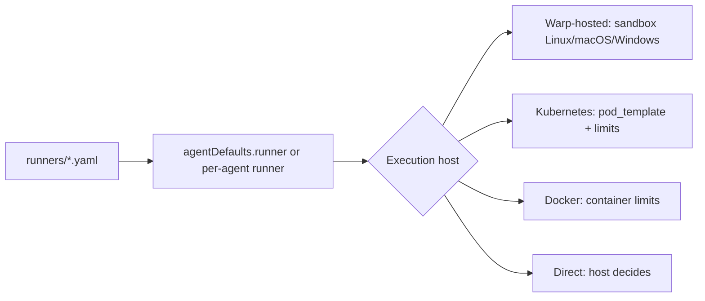

# Runners for Warp Factories

> [[raw/docs/llms-docs-warp-dev/factories-runners|Raw]] · llms-txt

## Summary

The docs state that a runner is a reusable compute configuration for cloud agent runs: operating system, CPU architecture, instance size and sandbox image. An environment supplies repositories, toolchain and workspace setup; the execution host decides whether work runs on Warp-hosted infrastructure or a self-hosted worker. Teams can reuse one runner across workflows, or pick small sizes for light checks and large ones for heavy builds. [[raw/docs/llms-docs-warp-dev/factories-runners#Runners for Warp Factories|cite]]

Runners are declared as `runners/*.yaml` in the factory definition. Factory agents inherit `agentDefaults.runner` unless an agent or automation sets its own `runner`. The default must be Linux, because it supplies the factory-managed environment. Warp-managed factories edit runner files in the dashboard; GitHub-backed factories edit them by pull request. [[raw/docs/llms-docs-warp-dev/factories-runners#Defaults and overrides|cite]]

The same runner fields mean different things per backend. On Warp-hosted runs they provision the sandbox. On self-hosted backends they do not provision capacity: worker configuration controls resources, registry auth, volumes and placement. [[raw/docs/llms-docs-warp-dev/factories-runners#Runner settings by execution host|cite]]

## Key claims

- Warp-hosted runs clone repos, then run the runner's `setupCommands` in order, then the environment's setup commands. A setup command that exits nonzero or runs over 30 minutes fails the run. [[raw/docs/llms-docs-warp-dev/factories-runners#How runners fit into cloud agent runs|cite]]
- Warp-hosted Linux runs in a fresh Docker container (x86-64 or aarch64). Default image is `warpdotdev/dev-base:latest`. Private images use a team credential, with an AWS ECR guide linked. CPU and memory must be powers of two within plan limits. Docker containers and KVM VMs (Android emulator) are supported inside. [[raw/docs/llms-docs-warp-dev/factories-runners#Operating systems|cite]]
- Warp-hosted macOS runs in a fresh Apple Silicon VM (macOS 14, 15, 26 or 27; default 26) with Xcode and iOS/watchOS/tvOS simulators. Sizes range from 4 vCPU/7 GB to 12 vCPU/56 GB. [[raw/docs/llms-docs-warp-dev/factories-runners#Operating systems|cite]]
- Windows runners are Warp-hosted only, x86-64 only, use PowerShell-compatible setup, and take no Docker image. Self-hosted Docker and Kubernetes backends run Linux tasks only. [[raw/docs/llms-docs-warp-dev/factories-runners#Operating systems|cite]]
- On Kubernetes, `instanceShape` becomes task-container requests and limits and overrides matching `pod_template` resources. On Docker it sets container limits. On Direct it is ignored. [[raw/docs/llms-docs-warp-dev/factories-runners#Runner settings by execution host|cite]]
- The legacy Oz CLI manages runners (`oz runner create|list|update|delete`) and passes one to a standalone run via `oz agent run-cloud --runner`. [[raw/docs/llms-docs-warp-dev/factories-runners#Managing runners with the legacy CLI|cite]]

## Notable quotes

> "Self-hosted runner settings don’t provision capacity."
> — [[raw/docs/llms-docs-warp-dev/factories-runners#Runner settings by execution host|location]]

## Connections

- **Entities**: [[wiki/entities/warp-factories]], [[wiki/entities/docker]], [[wiki/entities/kubernetes]], [[wiki/entities/aws-ecr]]
- **Concepts**: [[wiki/concepts/agent-runner]], [[wiki/concepts/self-hosting]], [[wiki/concepts/factory-as-code]], [[wiki/concepts/dev-environment]]

> Synthesis: Vendor reference for the compute layer under a factory; pairs with the self-hosting and factory-as-code pages, and its per-backend table shows the same config being advisory when self-hosted.
