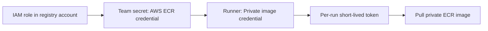

# Configuring AWS ECR credentials

> [[raw/docs/llms-docs-warp-dev/factories-secrets-aws-ecr|Raw]] · llms-txt

## Summary

The docs state that an "AWS ECR credential" lets a Warp-hosted Linux runner pull private Amazon ECR images. Warp stores the IAM role ARN and requests a short-lived token per run. The credential must be created in the web app, not the legacy CLI. [[raw/docs/llms-docs-warp-dev/factories-secrets-aws-ecr#Configuring AWS ECR credentials|cite]]

Setup has two halves: create the secret (type "AWS ECR credential", with role ARN and region), then attach it to a runner. [[raw/docs/llms-docs-warp-dev/factories-secrets-aws-ecr#Creating the ECR credential|cite]] [[raw/docs/llms-docs-warp-dev/factories-secrets-aws-ecr#Attaching the credential to a runner|cite]]

## Key claims

- The form shows the trust and permissions policies for the IAM role. If repository read actions are scoped to a repository ARN, `ecr:GetAuthorizationToken` must stay on `Resource: "*"`. [[raw/docs/llms-docs-warp-dev/factories-secrets-aws-ecr#Creating the ECR credential|cite]]
- Warp derives the registry host from the role's account ID and region. Creation checks role assumption and token retrieval only, not repository-specific pull permissions. [[raw/docs/llms-docs-warp-dev/factories-secrets-aws-ecr#Creating the ECR credential|cite]]
- Warp-managed factories attach it in Settings > Runners > Edit runner > "Private image credential". An externally managed runner sets `platform.linux.registryCredentialSecretName` in its YAML and applies it via pull request. [[raw/docs/llms-docs-warp-dev/factories-secrets-aws-ecr#Attaching the credential to a runner|cite]]
- The credential authenticates image pulls only and is not injected into the agent environment. Self-hosted workers use backend-specific registry authentication instead. [[raw/docs/llms-docs-warp-dev/factories-secrets-aws-ecr#Attaching the credential to a runner|cite]]
- Pull permissions needed on the repository: `ecr:BatchCheckLayerAvailability`, `ecr:BatchGetImage`, `ecr:GetDownloadUrlForLayer`. The credential's registry host must match the image's registry. [[raw/docs/llms-docs-warp-dev/factories-secrets-aws-ecr#ECR image pulls fail|cite]]
- Role assumption failures: trust policy must match the form, including the team's `sts:ExternalId`; AWS returns `AccessDenied` for both missing roles and trust denials. [[raw/docs/llms-docs-warp-dev/factories-secrets-aws-ecr#ECR role assumption fails|cite]]
- To retire: remove runner references first, then delete the team secret. Permission changes are made in the IAM role in AWS. [[raw/docs/llms-docs-warp-dev/factories-secrets-aws-ecr#Changing permissions or retiring the credential|cite]]

## Notable quotes

> "Warp stores the role ARN and requests a short-lived token per run."
> — [[raw/docs/llms-docs-warp-dev/factories-secrets-aws-ecr#Configuring AWS ECR credentials|cite]]

## Connections

- **Entities**: [[wiki/entities/warp-factories]], [[wiki/entities/aws-ecr]]
- **Concepts**: [[wiki/concepts/secrets-management]], [[wiki/concepts/agent-runner]], [[wiki/concepts/self-hosting]], [[wiki/concepts/factory-as-code]]

> Synthesis: Vendor doc; stores only a role ARN, never a static registry password, so the secret is a pointer to an assumable role rather than key material. Image-pull auth is deliberately separated from the agent's runtime environment.
