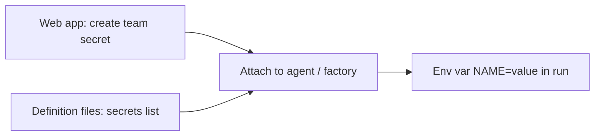

# Managing factory secrets

> [[raw/docs/llms-docs-warp-dev/factories-secrets|Raw]] · llms-txt

## Summary

The docs state that secrets give factory agents credentials for external services without putting values in prompts or definition files. The running example is a reporting agent holding a read-only `METABASE_API_KEY`. Secrets are created on a team-wide "Secrets" page in the Warp Factories web app, not per factory. [[raw/docs/llms-docs-warp-dev/factories-secrets#Managing factory secrets|cite]]

Creating a secret grants nothing by itself. Access is attached per agent (web app, Warp-managed factories) or declared in definition files, where agent frontmatter lists secret names and never values. Three list levels exist: factory-wide `secrets`, `agentDefaults.secrets`, and per-agent `secrets`. Raw values reach the agent as environment variables named after the secret. [[raw/docs/llms-docs-warp-dev/factories-secrets#Secret ownership and agent access|cite]] [[raw/docs/llms-docs-warp-dev/factories-secrets#Factory-wide and inherited access|cite]]

The page also covers lifecycle: verifying injection with a fresh run, rotating a value in place (same name, so references survive), removing one agent's access, permanently deleting a secret, and a per-variable size cap. This is vendor documentation, so all claims are the vendor's account.

## Key claims

- The docs state a team secret is not automatically available to agents; it must be attached to an agent or included in factory configuration, and injected as an environment variable using the secret name. [[raw/docs/llms-docs-warp-dev/factories-secrets#Secret ownership and agent access|cite]]
- Per-agent `secrets` replaces the default list; an empty list removes inherited defaults but not factory-wide secrets. [[raw/docs/llms-docs-warp-dev/factories-secrets#Factory-wide and inherited access|cite]]
- Externally managed factories have read-only configuration in the web app; changes go through the definition repo and a pull request to the production branch. [[raw/docs/llms-docs-warp-dev/factories-secrets#Using definition files|cite]]
- Harness authentication, inference credentials and MCP credentials use separate configuration; private Amazon ECR images use a dedicated ECR credential flow rather than a raw-value secret. [[raw/docs/llms-docs-warp-dev/factories-secrets#Secret ownership and agent access|cite]]
- Each injected `NAME=value` entry must fit within 128 KiB (131,072 bytes) including the null terminator; larger payloads belong in an object store or external secret manager, keeping only the fetch credential in Warp. [[raw/docs/llms-docs-warp-dev/factories-secrets#A secret value is too large|cite]]
- Rotation replaces the value under the same name; new runs use it, and webhooks pick it up only when their definition is reapplied. Deletion is permanent and affects every agent, webhook or runner referencing it. [[raw/docs/llms-docs-warp-dev/factories-secrets#Rotating a raw-value secret|cite]] [[raw/docs/llms-docs-warp-dev/factories-secrets#Removing access or deleting a secret|cite]]

## Notable quotes

> "Creating a team secret doesn’t automatically give every agent access."
> — [[raw/docs/llms-docs-warp-dev/factories-secrets#Secret ownership and agent access|location]]

> "Never print credentials or include them in outputs."
> — [[raw/docs/llms-docs-warp-dev/factories-secrets#Using definition files|location]]

## Connections

- **Entities**: [[wiki/entities/warp-factories]], [[wiki/entities/aws-ecr]]
- **Concepts**: [[wiki/concepts/secrets-management]], [[wiki/concepts/factory-as-code]], [[wiki/concepts/webhook]], [[wiki/concepts/mcp]]

> Synthesis: Core page for secrets-management in Warp Factories; shows least-privilege env-var injection with names in git and values only in the platform, complementing the factory-as-code and infrastructure pages.
