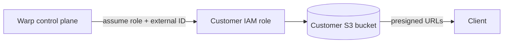

# Self-hosted agent data storage

> [[raw/docs/llms-docs-warp-dev/factories-self-hosting-data-storage|Raw]] · llms-txt

## Summary

This is a vendor setup guide for keeping cloud agent run data in storage the customer owns. The docs state that conversation transcripts, artifacts and prompt attachments can live in the team's bucket instead of Warp-managed storage, while the Automation Platform still orchestrates every run and routes model inference. [[raw/docs/llms-docs-warp-dev/factories-self-hosting-data-storage#Self-hosted agent data storage|cite]] The feature is Enterprise-only.

Each of the three categories is mapped independently. An unmapped category stays on Warp-hosted storage, so artifacts can go to your bucket while transcripts stay with Warp. [[raw/docs/llms-docs-warp-dev/factories-self-hosting-data-storage#What data can be self-hosted|cite]] Warp's control plane reaches the bucket through a cross-account IAM role the customer creates and can revoke. It writes during a run, reads to serve history and screenshots, and touches data for background work such as scorers. [[raw/docs/llms-docs-warp-dev/factories-self-hosting-data-storage#How data flows|cite]]

The bulk of the page is an AWS S3 walkthrough, given in AWS CLI and Terraform variants. The Admin Panel dialog generates the trust and permissions policies, and Warp validates the connection on submit.

## Key claims

- Providers: AWS S3 and Azure Blob Storage are available (Azure enabled via sales); Google Cloud Storage is planned. [[raw/docs/llms-docs-warp-dev/factories-self-hosting-data-storage#Supported storage providers|cite]]
- Only team admins can connect, remap or disconnect storage. Changing mappings does not migrate data: old objects stay in place but are no longer reachable through Warp APIs. [[raw/docs/llms-docs-warp-dev/factories-self-hosting-data-storage#What data can be self-hosted|cite]]
- Warp never caches bucket contents and uses presigned URLs where possible, so data flows from the bucket to the client without passing through Warp's backend. [[raw/docs/llms-docs-warp-dev/factories-self-hosting-data-storage#How data flows|cite]]
- Setup needs a bucket (SSE-S3 or SSE-KMS), CORS allowing `GET` from `https://*.warp.dev`, and an IAM role whose trust policy names Warp's broker role with an `sts:ExternalId` equal to the team ID. [[raw/docs/llms-docs-warp-dev/factories-self-hosting-data-storage#1\. Create an S3 bucket|cite]]
- The permissions policy grants `s3:ListBucket`, `s3:GetObject`, `s3:PutObject` and `s3:DeleteObject` on that bucket only. SSE-KMS buckets need an extra `kms:Decrypt`, `kms:GenerateDataKey*`, `kms:DescribeKey` statement. [[raw/docs/llms-docs-warp-dev/factories-self-hosting-data-storage#4\. Attach the permissions policy|cite]]
- A bucket must be unmapped from every category before disconnecting. Disconnecting leaves existing objects in the customer's account; Warp just stops referencing them. [[raw/docs/llms-docs-warp-dev/factories-self-hosting-data-storage#Changing or removing storage|cite]]
- Connection errors map to three causes: role not assumable (trust policy or external ID), access denied (permissions policy), bucket unreachable (wrong name or region). [[raw/docs/llms-docs-warp-dev/factories-self-hosting-data-storage#Troubleshooting|cite]]

## Notable quotes

> "Warp never caches bucket contents. It uses presigned URLs wherever possible so that data flows directly from your bucket to the client, without transiting Warp's backend."
> — [[raw/docs/llms-docs-warp-dev/factories-self-hosting-data-storage#How data flows|how data flows]]

## Connections

- **Entities**: [[wiki/entities/warp-factories]]
- **Concepts**: [[wiki/concepts/self-hosting]], [[wiki/concepts/control-plane]]

> Synthesis: Vendor doc on the data-residency half of self-hosting (storage, not compute); it shows the control plane staying hosted by Warp while run data moves to customer-owned buckets.
