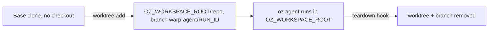

# Isolating Direct backend tasks with Git worktrees

> [[raw/docs/llms-docs-warp-dev/factories-self-hosting-direct-monorepo-worktrees|Raw]] · llms-txt

## Summary

This self-hosting how-to describes one pattern: one Git worktree per Direct backend task. The docs state it shares a large monorepo's object store without sharing branch or working files, so concurrent agents do not edit the same checkout and no full clone is needed per run. [[raw/docs/llms-docs-warp-dev/factories-self-hosting-direct-monorepo-worktrees#Isolating Direct backend tasks with Git worktrees|cite]]

The recipe has four parts: a dedicated `--no-checkout` base clone refreshed outside the task lifecycle; a `setup_command` script that adds a worktree at `OZ_WORKSPACE_ROOT/repo` on branch `warp-agent/<OZ_RUN_ID>` and appends `REPO_ROOT` and `AGENT_BRANCH` to the task environment file; a `teardown_command` script that removes worktree and branch; and a `worker.yaml` wiring both hooks with `max_concurrent_tasks`. [[raw/docs/llms-docs-warp-dev/factories-self-hosting-direct-monorepo-worktrees#How the worktree lifecycle works|cite]]

The docs are vendor documentation; claims below are the vendor's account.

## Key claims

- The docs state the `oz` CLI starts in `OZ_WORKSPACE_ROOT`, not the worktree. `REPO_ROOT` does not change that, so each task prompt or agent instruction must keep repo commands and edits under `repo/`, or the task may not find the monorepo. [[raw/docs/llms-docs-warp-dev/factories-self-hosting-direct-monorepo-worktrees#How the worktree lifecycle works|cite]]
- The worktree must be a child of the workspace, because the worker has already created the workspace and a temporary env file there; Git cannot turn that directory into a worktree. [[raw/docs/llms-docs-warp-dev/factories-self-hosting-direct-monorepo-worktrees#How the worktree lifecycle works|cite]]
- Worktrees isolate files and branches, not the host. Direct tasks share the worker's filesystem, network, processes and object store, so the docs advise dedicated hosts and credentials matched to repo trust level. [[raw/docs/llms-docs-warp-dev/factories-self-hosting-direct-monorepo-worktrees#How the worktree lifecycle works|cite]]
- The Direct backend sets `GIT_CONFIG_GLOBAL` to a task-local file. Credentials must come from an SSH key in the service account home, a system credential helper, or a helper in the base clone's config. [[raw/docs/llms-docs-warp-dev/factories-self-hosting-direct-monorepo-worktrees#Preparing the base clone|cite]]
- Fetch happens outside the setup hook (for example from a timer) so concurrent tasks do not update the same remote-tracking refs. [[raw/docs/llms-docs-warp-dev/factories-self-hosting-direct-monorepo-worktrees#Preparing the base clone|cite]]
- Both hooks call `git worktree prune` so interrupted tasks recover. With `--no-cleanup` or `cleanup: false`, teardown is skipped and the operator must run it manually and delete the workspace. Teardown deletes only the local branch, not a pushed branch or PR. [[raw/docs/llms-docs-warp-dev/factories-self-hosting-direct-monorepo-worktrees#Creating the teardown hook|cite]]

## Notable quotes

> "Worktrees isolate working files and branches, not the host OS."
> — [[raw/docs/llms-docs-warp-dev/factories-self-hosting-direct-monorepo-worktrees#How the worktree lifecycle works|location]]

## Connections

- **Entities**: [[wiki/entities/warp-factories]]
- **Concepts**: [[wiki/concepts/git-worktree]], [[wiki/concepts/self-hosting]], [[wiki/concepts/agent-runner]], [[wiki/concepts/secrets-management]]

> Synthesis: Concrete self-hosting recipe for parallel-agent isolation; worktrees give cheap per-task checkouts but not a security boundary, and the working-directory gotcha means the prompt, not the harness, must point the agent at the repo.
