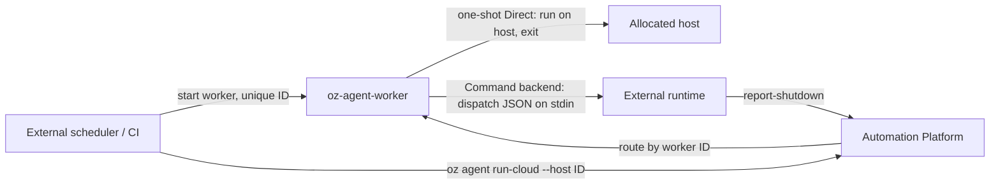

# Running agents with an external orchestrator

> [[raw/docs/llms-docs-warp-dev/factories-self-hosting-external-orchestrators|Raw]] · llms-txt

## Summary

This is vendor documentation. The docs state that an existing CI system, Kubernetes controller or internal scheduler can own compute allocation while the Automation Platform still accepts triggers, routes runs and tracks them. Both patterns are "managed": Warp routes, the orchestrator provides hosts. If the orchestrator should also start each agent process without Warp routing, the docs point to unmanaged execution instead. [[raw/docs/llms-docs-warp-dev/factories-self-hosting-external-orchestrators#Choosing a pattern|cite]]

Two patterns are offered. **One-shot Direct**: the scheduler creates a VM, pod or CI runner per job, starts `oz-agent-worker --one-shot` with a unique worker ID, and creates a run targeting that ID with `oz agent run-cloud --host`. The worker accepts one task, forces `max_concurrent_tasks` to 1, and exits. **Command backend**: a long-lived worker pipes each task as JSON on stdin to a `dispatch_command`; the external runtime (job API, queue, scheduler) owns the task lifecycle. [[raw/docs/llms-docs-warp-dev/factories-self-hosting-external-orchestrators#Using the Command backend|cite]]

## Key claims

- One-shot mode exits after the task succeeds, fails or is cancelled; with no task it stays connected until the orchestrator stops it. A unique worker ID per job stops another worker claiming the run. [[raw/docs/llms-docs-warp-dev/factories-self-hosting-external-orchestrators#Using one-shot Direct|cite]]
- Idle timeout precedence: task-level `config.idle_timeout_minutes`, then the worker's `idle_on_complete` / `--idle-on-complete`, then a 45-minute default. Direct Agent API runs default to 10 minutes; `oz agent run-cloud` leaves it unset. For immediate exit use `0` or `--idle-on-complete 0s`. [[raw/docs/llms-docs-warp-dev/factories-self-hosting-external-orchestrators#Configure the completion timeout|cite]]
- A run can enter the queue before its worker connects; if no matching worker claims it, Warp eventually fails it. [[raw/docs/llms-docs-warp-dev/factories-self-hosting-external-orchestrators#Start the worker and route the run|cite]]
- Command backend: exit code 0 from dispatch means the runtime durably accepted the task; nonzero exit or dispatch timeout fails it. [[raw/docs/llms-docs-warp-dev/factories-self-hosting-external-orchestrators#Using the Command backend|cite]]
- The worker does not wait for the remote agent. Restarting it does not cancel accepted tasks, and `max_concurrent_tasks` limits concurrent dispatch calls, not agents in the external runtime. [[raw/docs/llms-docs-warp-dev/factories-self-hosting-external-orchestrators#Using the Command backend|cite]]
- Dispatch scripts must keep the task payload out of logs (it holds task credentials) and, after the CLI exits, run `oz harness-support --run-id RUN_ID report-shutdown` so Warp gets the terminal state. [[raw/docs/llms-docs-warp-dev/factories-self-hosting-external-orchestrators#Using the Command backend|cite]]
- Credentials: one agent key may serve both worker and `run-cloud`; across separate processes use a self-hosted worker key for the worker and an agent key for the run creator. [[raw/docs/llms-docs-warp-dev/factories-self-hosting-external-orchestrators#Start the worker and route the run|cite]]

## Notable quotes

> "Use an existing CI system, Kubernetes controller, or internal scheduler to allocate compute while the Automation Platform routes and tracks each run."
> — [[raw/docs/llms-docs-warp-dev/factories-self-hosting-external-orchestrators#Running agents with an external orchestrator|intro]]

## Connections

- **Entities**: [[wiki/entities/warp-factories]], [[wiki/entities/kubernetes]], [[wiki/entities/docker]]
- **Concepts**: [[wiki/concepts/self-hosting]], [[wiki/concepts/agent-runner]], [[wiki/concepts/secrets-management]]

> Synthesis: Narrow integration page that splits scheduling (yours) from routing and tracking (Warp's); it extends the self-hosting overview and Direct backend pages rather than adding a new idea.
